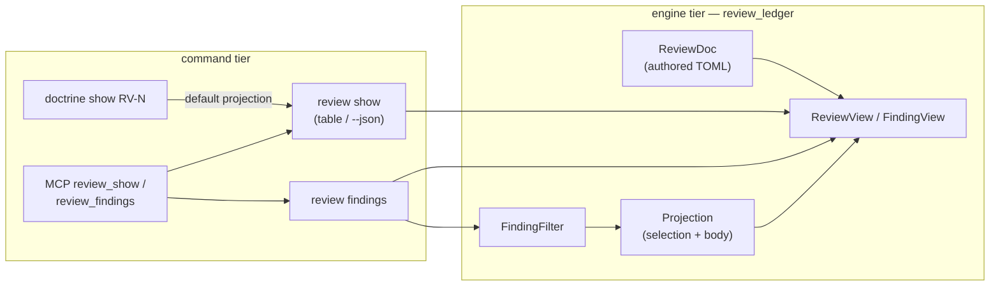
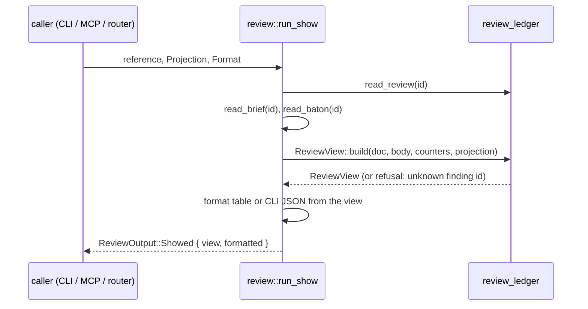

<!-- doctrine:section sec-1 -->
## What changes and why

A review ledger (an `RV`, ADR-007) holds findings: each has a severity, a
status, a title, a `detail` explaining the problem, the responder's
`disposition` and `response`, an optional `route`, and a turn journal recording
every act on it (SL-268). Today `doctrine review show RV-NNN` prints a header,
a one-line index per finding, and the whole brief. The reasoning — detail,
response, route, journal — is reachable only through `--json`, which dumps the
raw ledger under a leaked TOML key (`review.finding`), while MCP `review_show`
returns a different shape (`findings`). Nothing lists findings across reviews.

This slice gives the ledger one read model and renders every surface from it:

- **`ReviewView`** — an owned, serialisable projection of one review, built in
  the engine-tier `review_ledger` module (DEC-361).
- **`review show`** — an index by default; `-f F-3,F-5` or `--full` for
  findings in full; `--open`, `-s`, `-S` to narrow which findings appear
  (DEC-362, DEC-363, DEC-367).
- **One JSON shape** — CLI `--json` and MCP `review_show` carry the identical
  inner view (DEC-368, DEC-369).
- **`doctrine review findings`** — a corpus census of findings, with an MCP
  twin (DEC-370).
- **`--facet`** on `review list` and the census (DEC-365).

The ledger schema and every write verb are untouched: this slice reads what
SL-268 wrote. RV as a relation target (RFC-032 `D14`) is SL-279's.

The diagram shows where the projection sits relative to the surfaces that
render it; arrows are calls.



`doctrine show RV-N` forwards only `--format`, so it always renders the
default projection (DEC-364). MCP reaches the ledger through the same
`review::run_show` / `run_findings` functions the CLI uses; it never builds its
own projection.

<!-- doctrine:section sec-2 -->
## The view: `ReviewView` in `review_ledger`

A new file, `src/review_ledger/view.rs`, owns the projection, the selection
arguments, and the finding filter. It imports only `review_ledger` siblings,
`serde`, and leaf modules (ADR-001). It is pure: no disk, no clock — the shell
reads the ledger, the brief, and the baton, and passes them in.

### Current vs target

| | today | target |
|---|---|---|
| home | `review/read.rs`, `pub(super)`, command tier | `review_ledger/view.rs`, `pub(crate)`, engine tier |
| ownership | borrows `&'a ReviewDoc`, no serde | owned, `Serialize` |
| finding type | `review::Finding` (one of three `Finding` types) | `FindingView` |
| warnings type | `review::ReviewWarning` | moves with the view, same name and wire shape |
| JSON | `ShowJson` flattens `ReviewDoc` (leaks `review.finding`) | serialises `ReviewView` |
| MCP | `project_show_summary` rewrites `Showed` | deleted; MCP serialises the view |

### Types

```rust
/// How much of each shown finding a render carries.
#[derive(Debug, Clone, Copy, PartialEq, Eq, Serialize)]
#[serde(rename_all = "lowercase")]
pub(crate) enum Depth { Index, Full }

/// Which findings a view carries. Ids and filters are exclusive by
/// construction: the CLI and MCP refuse the combination before this exists.
pub(crate) enum Selection {
    /// Every finding the filter admits (an empty filter admits all).
    Filtered(FindingFilter),
    /// Exactly these ids, normalised to `F-n`, in the order given.
    Ids(Vec<String>),
}

pub(crate) struct Projection {
    pub(crate) selection: Selection,
    /// `--full`: carry the brief body.
    pub(crate) with_body: bool,
}

impl Projection {
    /// `Full` iff `with_body` or `Selection::Ids`; else `Index`.
    pub(crate) fn depth(&self) -> Depth;
    /// The default render — what `doctrine show RV-N` gets.
    pub(crate) fn index() -> Self;
    /// Parse the transport-neutral arguments both CLI and MCP collect.
    pub(crate) fn parse(args: ProjectionArgs) -> anyhow::Result<Self>;
}

/// Raw strings as either transport delivers them; `parse` validates.
#[derive(Default)]
pub(crate) struct ProjectionArgs {
    pub(crate) finding: Vec<String>,  // "F-3" or "3"
    pub(crate) full: bool,
    pub(crate) open: bool,
    pub(crate) status: Vec<String>,   // FINDING_STATUSES
    pub(crate) severity: Vec<String>, // SEVERITIES
}

#[derive(Default)]
pub(crate) struct FindingFilter {
    pub(crate) open: bool,
    pub(crate) statuses: Vec<FindingStatus>,
    pub(crate) severities: Vec<Severity>,
}

impl FindingFilter {
    /// Split commas, validate against the vocabularies, build. Called by
    /// `Projection::parse` and by the census, so both refuse alike.
    pub(crate) fn parse(open: bool, status: &[String], severity: &[String])
        -> anyhow::Result<Self>;
}
```

`Projection::parse` is the single validation point, so CLI and MCP refuse
with identical messages: an unknown status or severity names the vocabulary
(the `listing::validate_statuses` shape); `finding` together with any filter
is refused ("`--finding` selects exact findings; drop `--open`/`-s`/`-S`").
Comma splitting happens here too, so MCP may pass `"3,5"` or `["3","5"]`.

### The filter predicate (DEC-363)

```rust
impl FindingFilter {
    pub(crate) fn admits(&self, row: &FindingRow) -> bool {
        let status = Vocab::<FindingStatus>::read(&row.status);
        (!self.open || !status.is_known_terminal())
            && (self.statuses.is_empty()
                || status.known().is_some_and(|s| self.statuses.contains(&s)))
            && (self.severities.is_empty()
                || self.severities.contains(&effective_severity(&row.severity)))
    }
}
```

The census (sec-5) builds the same `FindingFilter` from its list flags, so
this is the only implementation of the finding axes.

`effective_severity(raw) -> Severity` maps an out-of-vocabulary severity to
`Blocker` (SPEC-032 `D15`, the fail-safe read). It is extracted from
`outstanding_by_severity`'s match in `gate.rs`, which then calls it, so the
census, `show`, and the close gate cannot classify severity differently. An
out-of-vocabulary status is open under `--open` and matches no `-s` value
(it cannot be named).

### The view

```rust
#[derive(Debug, Clone, PartialEq, Eq, Serialize)]
pub(crate) struct ReviewView {
    pub(crate) canonical: String,          // "RV-012"
    pub(crate) title: String,
    pub(crate) facet: String,
    pub(crate) status: ReviewStatus,       // derived (D-C8), never stored
    pub(crate) awaiting: Await,            // derived
    pub(crate) target: String,             // "SL-024" or "SL-024@PHASE-03"
    pub(crate) raiser: String,
    pub(crate) responder: String,
    pub(crate) rounds: u32,
    pub(crate) concluded: bool,
    #[serde(skip_serializing_if = "Vec::is_empty")]
    pub(crate) tags: Vec<String>,
    pub(crate) depth: Depth,
    pub(crate) finding_count: usize,       // the whole ledger
    pub(crate) outstanding: Outstanding,   // the whole ledger
    pub(crate) findings: Vec<FindingView>, // the selected set
    #[serde(skip_serializing_if = "Option::is_none")]
    pub(crate) body: Option<String>,       // only with --full
    #[serde(skip_serializing_if = "Option::is_none")]
    pub(crate) body_lines: Option<usize>,  // whenever body is absent
    #[serde(skip_serializing_if = "Vec::is_empty")]
    pub(crate) warnings: Vec<ReviewWarning>,
}

#[derive(Debug, Clone, PartialEq, Eq, Serialize)]
pub(crate) struct FindingView {
    pub(crate) id: String,
    pub(crate) severity: Vocab<Severity>,
    pub(crate) status: Vocab<FindingStatus>,
    #[serde(skip_serializing_if = "Option::is_none")]
    pub(crate) disposition: Option<String>,
    #[serde(skip_serializing_if = "Option::is_none")]
    pub(crate) route: Option<String>,
    pub(crate) title: String,
    // Full depth only:
    #[serde(skip_serializing_if = "Option::is_none")]
    pub(crate) detail: Option<String>,
    #[serde(skip_serializing_if = "Option::is_none")]
    pub(crate) response: Option<String>,
    #[serde(skip_serializing_if = "Vec::is_empty")]
    pub(crate) turns: Vec<TurnRow>,
}

/// Non-terminal findings by whose move they await, counted by severity.
#[derive(Debug, Clone, Copy, Default, PartialEq, Eq, Serialize)]
pub(crate) struct Outstanding {
    pub(crate) responder: OutstandingCounts,
    pub(crate) raiser: OutstandingCounts,
}

impl ReviewView {
    pub(crate) fn build(
        doc: &ReviewDoc,
        body: &str,
        legacy_counters: (u32, u32), // the baton's (rounds, contests)
        projection: &Projection,
    ) -> anyhow::Result<Self>;
}
```

Notes on the choices:

- **Absence means "not requested", and `depth` says which.** At index depth
  `detail`, `response` and `turns` are absent; at full depth `response` is
  absent only when the finding has none. Field order in the struct is the JSON
  order: identity first, prose last.
- **Values are carried verbatim.** `disposition` and `route` stay raw strings
  (SPEC-032 `D8`: closed on write, open on read); severity and status are
  `Vocab<_>`, which serialises the raw token when out of vocabulary. `detail`
  is never shortened (DEC-366).
- **`turns` reuses the schema's `TurnRow`** (`act, role, note?, disposition?,
  route?, response?`), which already derives `Serialize`; a second turn type
  would only be a copy. The review-level journal (`[[review.turn]]`, acts that
  move no finding) is not projected; it already feeds `rounds`.
- **`rounds` needs the baton** for a ledger never journalled
  (`review_ledger::counters`). `run_show` reads it with `read_baton` — a plain
  read, no lock, since nothing is written — and passes `(rounds, contests)`.
- **`Outstanding`** is built per finding: a non-terminal finding awaits the
  responder when `open`, `contested` or out of vocabulary, and the raiser when
  `answered` — the same rule `derived_status` applies to the whole review,
  extracted as `finding_await(&Vocab<FindingStatus>) -> Await` in `derive.rs`
  so both use it. Each party's counts reuse `OutstandingCounts` (which gains
  `Serialize`) and `effective_severity`. The status/await enums gain
  `Serialize` with `rename_all = "lowercase"`, matching their `as_str` tokens.
- **Selection by id** keeps the order given and refuses an unknown id naming
  the ledger's ids (`unknown finding F-9 on RV-012 (has F-1..F-5)` — the list
  written out, not a range, when ids are sparse). A duplicate id is shown once.
- **Header facts cover the whole ledger** (`finding_count`, `outstanding`,
  `warnings`) whatever the selection, so a filtered view never hides what the
  review still holds.

<!-- doctrine:section sec-3 -->
## Renders: table and JSON

Both renders live in `src/review/read.rs` and read only the `ReviewView`. The
table additionally takes the estimate and value lines, which the shell
resolves from the priority surface as it does today.

### Table, default (index depth) — DEC-367

```text
RV-012 — Design review: SL-278
design · active · await=responder · rounds 7 · concluded
RV-012 ──reviews──▶ SL-278
raiser claude · responder gpt
outstanding: 1 BLOCKER, 2 MAJOR await responder · 1 minor awaits raiser
findings: 5
id   │ severity │ status   │ disposition │ route  │ title
F-1  │ BLOCKER  │ open     │ —           │        │ Gate reads stale view
F-2  │ MAJOR    │ answered │ fix         │ review │ ...
...
warning: RV-012 F-4 severity `critcal` (gating as blocker)
tags: ...
<estimate line> / <value line>
brief: 42 lines — doctrine review show RV-012 --full · -f F-2,F-3 for chosen findings
```

Line by line:

- **Status line** — facet, derived status, await, `rounds N`, and
  ` · concluded` only when set (the `review status` convention).
- **Outstanding line** — non-terminal findings grouped by the party they
  await, responder first, each group listing non-zero severities in
  vocabulary order. `outstanding: none` when every finding is terminal.
- **`findings:`** — `findings: 5` when all are shown; `findings: 2 of 5`
  when a filter or `-f` narrowed the set, so a narrowed index never reads as
  the whole ledger. An empty ledger prints `findings: 0` and no table.
- **Index** — rendered through `listing::render_table` as now. The `route`
  column appears only when a shown finding has a route. In this table and the
  census, `blocker` and `major` print as `BLOCKER` and `MAJOR`; an
  out-of-vocabulary severity prints verbatim; JSON always carries the
  lowercase token. One helper, `severity_cell(&Vocab<Severity>) -> String`,
  serves both tables.
- **Warnings** — the existing `warning:` lines, unchanged (STD-003).
- **Brief hint** — replaces the brief body. It names the line count and the
  two invocations that reach detail, using the review's own id. `brief: empty`
  when the body has no lines.

### Table, full depth

`-f` or `--full` replaces the index with one block per shown finding, then
(with `--full` only) the brief body after a blank line, as today.

```text
F-2 · MAJOR · answered · disposition fix · route review
  Gate reads stale view

  detail:
    <detail, verbatim, every line indented four spaces>
  response:
    <response, verbatim>
  turns:
    raise · raiser
    dispose · responder · fix → review
      <turn note or response, indented>
```

`disposition`, `route`, `response` and `turns` lines appear only when set.
Blocks are separated by a blank line. Indentation is the only transformation
applied to prose; nothing is wrapped or cut (DEC-366).

### JSON — DEC-368

The CLI wraps the view in the report envelope; MCP wraps it in the outcome
tag every review tool uses. The inner object is the same bytes.

```json
{ "kind": "review",
  "review": {
    "canonical": "RV-012", "title": "Design review: SL-278",
    "facet": "design", "status": "active", "awaiting": "responder",
    "target": "SL-278", "raiser": "claude", "responder": "gpt",
    "rounds": 7, "concluded": false,
    "depth": "index", "finding_count": 5,
    "outstanding": {
      "responder": { "blocker": 1, "major": 2, "minor": 0, "nit": 0 },
      "raiser":    { "blocker": 0, "major": 0, "minor": 1, "nit": 0 } },
    "findings": [
      { "id": "F-2", "severity": "major", "status": "answered",
        "disposition": "fix", "route": "review",
        "title": "Gate reads stale view" } ],
    "body_lines": 42 } }
```

MCP: `{"Showed": { …same object… }}`. At full depth each finding adds
`detail`, `response` (when set) and `turns`; with `--full`, `body` replaces
`body_lines`. The ledger's `review.finding` array, the old top-level `body`
and `warnings`, the MCP `id` integer and `findings` of raw `Finding`s are all
gone.

### `ReviewOutput::Showed`

```rust
Showed {
    #[serde(flatten)]
    view: ReviewView,
    #[serde(skip)]
    formatted: String,
}
```

`run_show` builds the view once and derives both the table string and the
CLI JSON string from it. The CLI JSON is `json!({"kind": "review", "review":
view})`; the `with_warnings` helper and `ShowJson` are deleted because
warnings now sit inside the view.

<!-- doctrine:section sec-4 -->
## Command surfaces

### `doctrine review show`

```rust
Show {
    reference: String,
    /// Findings to show in full: `F-3` or `3`, comma-separated, repeatable.
    #[arg(short = 'f', long = "finding", value_delimiter = ',')]
    finding: Vec<String>,
    /// Every finding in full, plus the brief.
    #[arg(long)]
    full: bool,
    /// Only non-terminal findings.
    #[arg(long, conflicts_with = "finding")]
    open: bool,
    /// Finding statuses, comma-separated, repeatable.
    #[arg(short = 's', long, value_delimiter = ',', conflicts_with = "finding")]
    status: Vec<String>,
    /// Severities, comma-separated, repeatable.
    #[arg(short = 'S', long, value_delimiter = ',', conflicts_with = "finding")]
    severity: Vec<String>,
    format: Format, json: bool, path: Option<PathBuf>,
}
```

Clap refuses `-f` with a filter first; `Projection::parse` refuses it again
so the MCP path, which has no clap, gets the same rule. `-f` with `--full`
shows the chosen findings in full plus the brief (DEC-362).

`run_show(path, reference, format)` becomes `run_show(path, reference,
&Projection, format)`. Its flow:



### `doctrine show RV-N` — DEC-364

The kind-blind router keeps forwarding only `--format`, and calls
`review::run_show` with `Projection::index()`. It therefore prints exactly
what plain `review show RV-N` prints, in both formats, and
`tests/e2e_show_equivalence.rs` keeps asserting byte equality unchanged. The
brief hint is how a reader of `doctrine show` finds `-f` and `--full`.

### MCP `review_show` — DEC-369

Schema properties: `reference` (required), `finding` (string or array),
`full`, `open` (booleans), `status`, `severity` (string or array). `view` and
`format` are removed, and `project_show_summary` with its tests is deleted.
The handler collects the arguments into `ProjectionArgs` and calls `Projection::parse`, and passes `Format::Json` to `run_show` — the
table string is `serde(skip)` on MCP and building it would only read config
for nothing. Unknown arguments stay ignored, so an old `view=summary` caller
now receives the smaller index rather than an error. The tool description is
rewritten to state the index default, the full-depth fields, and how to reach
them.

`ExtractFields::vec_str_field` reads arrays only and drops a scalar or a
non-string member silently, so it cannot serve here. A new
`ExtractFields::str_list_field(name) -> anyhow::Result<Vec<String>>` accepts a
string (kept whole; `Projection::parse` splits commas) or an array of strings,
and refuses any other JSON type or a non-string member, naming the argument.
`review_show` uses it for `finding`, `status` and `severity`;
`review_findings` for `status`, `severity` and `tags`.

### `review list --facet` — DEC-365

`List` gains `#[arg(long, value_parser = Facet::parse)] facet:
Option<Facet>`, applied with `--target` as a pre-filter before
`listing::retain`. MCP `review_list` gains a matching `facet` string,
validated with `Facet::parse`. The facet is a row predicate, so it does not
touch `CommonListArgs` (SPEC-013 keeps that bundle invariant).

<!-- doctrine:section sec-5 -->
## Findings census — DEC-370

`doctrine review findings` lists one row per finding across every review.
The bare verb answers "what is still open, anywhere"; flags narrow it. It is
nested under `review` because top-level `doctrine findings` is the unrelated
priority-graph report.

### Arguments

```rust
Findings {
    #[command(flatten)]
    list: crate::CommonListArgs,     // -f substr, -r, -i, -s, -t, -a, --format, --json, --columns
    #[arg(short = 'S', long, value_delimiter = ',')]
    severity: Vec<String>,
    #[arg(long, value_parser = Facet::parse)]
    facet: Option<Facet>,
    #[arg(long)]
    target: Option<String>,          // same parse and phase rule as review list
    #[arg(short = 'p', long)]
    path: Option<PathBuf>,
}
```

Here `-s` is the `CommonListArgs` status, meaning the listed row's status —
the finding's — validated against `FINDING_STATUSES`. `-f` is the list-wide
substring filter, not `--finding`; DEC-362 accepted that `-f` differs between
`show` and list verbs.

### Rows and filtering

```rust
#[derive(Debug, Serialize)]
pub(crate) struct CensusRow {
    pub(crate) review: String,     // "RV-012"
    pub(crate) facet: String,
    pub(crate) target: String,
    pub(crate) id: String,         // "F-3"
    pub(crate) severity: Vocab<Severity>,
    pub(crate) status: Vocab<FindingStatus>,
    #[serde(skip_serializing_if = "Option::is_none")]
    pub(crate) disposition: Option<String>,
    #[serde(skip_serializing_if = "Option::is_none")]
    pub(crate) route: Option<String>,
    pub(crate) title: String,
}
```

`run_findings` (in `src/review/census.rs`) scans all reviews tolerantly
(below), applies the review-level pre-filters (`--target`, `--facet`),
flattens to one row per finding, and filters rows in two steps with a strict
split of axes:

1. **Finding axes — `FindingFilter::admits`**, the predicate `review show`
   uses (DEC-363). The census builds it from its own flags:

   ```rust
   FindingFilter {
       // The list hide-set convention: terminal findings are hidden unless
       // -a or any -s is given — expressed as `open`, not as a second rule.
       open: !all && statuses.is_empty(),
       statuses,   // CommonListArgs -s
       severities, // -S
   }
   ```

   built through `FindingFilter::parse`, so a bad `-s` or `-S` value is
   refused with the same message `review show` gives.

   So `--open` semantics, unknown-status handling and severity classification
   have exactly one implementation.
2. **Text axes — `listing::retain`** for `-f`, `-r`, `-i`, `-t` only. The
   census takes `status` and `all` out of `ListArgs` before `listing::build`
   and passes an `is_hidden` that hides nothing, so `retain` never applies a
   status rule of its own. Its key gives each identifier its own field, because
   `listing::regex_admits` tests each field whole: `canonical` is the review id
   (`RV-012`), `slug` is the finding id (`F-3`), `title` the finding title,
   `tags` the review tags. So `-r '^RV-012$'` and `-r '^F-3$'` both match that
   row, as anchored id searches do on every other list verb. The substring
   domain (`-f`, slug + title) becomes finding id + finding title. The review
   slug is not searchable here; `--target` and the review id cover finding a
   review. The help text states both domains.

### Tolerant scan (STD-003)

The census walks the whole corpus, so one unparseable `review-NNN.toml` must
not deny every other review. A new reader in `review_ledger::schema`:

```rust
#[derive(Debug, Clone, PartialEq, Eq, Serialize)]
pub(crate) struct UnreadableReview { pub(crate) rv: String, pub(crate) reason: String }
// wire shape: {"rv": "RV-012", "reason": "<parse error>"}

/// Every review that parses, plus a named entry for each that does not.
pub(crate) fn scan_reviews(review_root: &Path)
    -> anyhow::Result<(Vec<ReviewDoc>, Vec<UnreadableReview>)>;
```

Only failure to list the review directory itself is an error. Each skipped
review is disclosed: a stderr line `warning: RV-012 unreadable: <reason>` in
the CLI, and an `unreadable` array (absent when empty) in JSON and MCP.
`review list` switches to `scan_reviews` too — it is the same walk with the
same defect today — and gains the same disclosure. `read_reviews` stays for
the close gate (`unresolved_blockers_for`), which must fail closed: a gate that
skipped an unreadable ledger could pass a blocker it never saw.

Rows sort by review id, then ledger order within a review. Table columns:
`review, facet, target, id, severity, status, disposition, route, title`;
the default visible set is `review, id, severity, status, target, title`,
and `--columns` reaches the rest. Severities print in capitals as in the
`show` index.

Warnings: the vocabulary defects of every review that contributed a row are
gathered as `review list` gathers them — to stderr in the CLI, and in a
top-level `warnings` array (absent when empty) in JSON and MCP. Unreadable
reviews ride beside them as `unreadable`.

### Output

CLI JSON uses the listing envelope: `{"kind": "finding", "rows": [...],
"warnings"?: [...]}`. `ReviewOutput` gains:

```rust
FindingsListed {
    rows: Vec<CensusRow>,
    #[serde(skip_serializing_if = "Option::is_none")]
    total: Option<usize>,
    #[serde(skip_serializing_if = "Vec::is_empty")]
    warnings: Vec<ReviewWarning>,
    #[serde(skip_serializing_if = "Vec::is_empty")]
    unreadable: Vec<UnreadableReview>,
    #[serde(skip)]
    formatted: String,
}
```

`ReviewOutput::Listed` gains the same `unreadable` field.

MCP `review_findings` takes `substr`, `regexp`, `status`, `tags`, `all`,
`severity`, `facet`, `target`, and `limit`, and returns
`{"FindingsListed": …}`. `limit` follows `review_list`: default 50, `0` for
all, and `total` present only when rows were dropped. `project_list_cap`
generalises over both listed variants rather than gaining a twin.

The census row's `kind` token is `"finding"`, a named constant beside
`REVIEW_KIND` (STD-001).

<!-- doctrine:section sec-6 -->
## Governance and guidance

### Rules applied

| rule | how this design meets it |
|---|---|
| ADR-001 layering | `view.rs` sits in engine-tier `review_ledger` and imports only its siblings and leaf modules. Renders, the census, and MCP stay command tier. `tests/architecture_layering.rs` gates it. |
| ADR-007 D-C8 / SPEC-032 derived status | `status`, `awaiting`, `outstanding` are computed in `ReviewView::build` on every read; nothing is cached or stored. |
| ADR-007 D-C5 | `turns` are emitted in file order; no global round is invented. |
| ADR-007 D-C6 | the brief stays part of the render — whole under `--full`, as a hint otherwise. |
| SPEC-032 `D8` | `disposition` and `route` render verbatim, legacy values included. |
| SPEC-032 `D15`, DEC-319, STD-003 | unknown status reads open, unknown severity reads blocker; every surface discloses defects on its own channel; `detail` is never cut; a narrowed index says `N of M`; the census and `review list` tolerate and name an unreadable review rather than aborting (the close gate stays fail-closed). |
| SPEC-013 D1/D3 | `findings` is a kind-specific verb over `listing` and flattens `CommonListArgs` without shadowing it; `-S`, `--facet`, `--target` are additions. |
| SPEC-013 show equivalence | `doctrine show RV-N` equals `review show RV-N` (DEC-364). |
| DEC-112 | report-verb JSON heads are free; this design picks `{kind, review}` and `{kind, rows}`. |
| POL-003 | one neutral projection in the core; MCP is a thin adapter over the same functions. |
| STD-001 | JSON keys come from serde field names on one struct; the census `kind` token and the depth tokens are named constants or enum variants, never repeated literals. |
| ADR-005, ADR-024 | shipped guidance explains in reference docs and routes from skills, citing only client-resolvable addresses. |

### Shipped guidance to update

- `install/review-ledger.md` — the read-surface section: depth, `-f`/`--full`,
  filters, the census, and the JSON shape. The route paragraph (`:246-248`)
  points at `review show RV-NNN -f F-n` and `findings[].route` in the unified
  shape.
- `.agents/skills/plan/SKILL.md:46-48` — drop the restated JSON path; point at
  `install/review-ledger.md` (ADR-005: skills route, docs explain). The `.pi/`
  and `plugins/` copies are regenerated, not hand-edited.
- `install/design-prompts/reviewing.md:165` — "read your response back with
  `review show <RV> -f F-n`", which now shows `response` directly.
- `.agents/skills/reconcile/SKILL.md:85` and `.agents/skills/audit/SKILL.md:42`
  — check the wording still holds against the index default; `--open` is the
  natural "is every finding terminal" read for reconcile.

### Memories

- `mem.pattern.design-run.review-disposition-route-and-vocab` — add how to
  read a route back (`review show -f`).
- `mem.pattern.doctrine.review-response-shell-backtick-mangling` — its
  read-back step becomes `review show RV-NNN -f F-n`.

### SPEC-032 revision

SPEC-032 (review ledger tech spec) states that `show --json` carries the whole
ledger (`:406-408`), which becomes false. At reconcile, a revision (REV) adds
a read-surface section (view, depth, selection, filters, census), registers
`findings` in the command family (`:376-380`), and updates the overview
(`:6-27`) and the fail-safe projection wording (`:316-318`). The design does
not edit the spec directly; ADR-013 routes governance change through a REV.

<!-- doctrine:section sec-7 -->
## Code impact

| path | change |
|---|---|
| `src/review_ledger/view.rs` | **new** — `Depth`, `Selection`, `Projection`, `ProjectionArgs`, `FindingFilter`, `ReviewView`, `FindingView`, `Outstanding`, `ReviewWarning` (moved), `warnings_of` (moved). |
| `src/review_ledger/mod.rs` | declare `view`; re-export its public items; promote `OutstandingCounts` out of the test-only export block. |
| `src/review_ledger/gate.rs` | extract `effective_severity`; `outstanding_by_severity` calls it; `OutstandingCounts` derives `Serialize`. |
| `src/review_ledger/derive.rs` | extract `finding_await`; `derived_status` calls it. |
| `src/review_ledger/vocab.rs` | `ReviewStatus` and `Await` derive `Serialize` (lowercase). |
| `src/review/read.rs` | delete `Finding`, the borrowed `ReviewView`, `finding_of_row`, `ShowJson`, `show_json`, `with_warnings`; `run_show` takes a `Projection`; table renders for index and full depth; `severity_cell`; brief hint; `render_finding` retypes onto `FindingRow`. |
| `src/review/census.rs` | **new** — `CensusRow`, `CENSUS_COLUMNS`, `run_findings`. |
| `src/review_ledger/schema.rs` | add `UnreadableReview` and `scan_reviews` (tolerant walk); `read_reviews` kept for the close gate. No schema change. |
| `src/commands/guard.rs` | classify `ReviewCommand::Findings` as `Read` in `write_class` (the match is exhaustive, so this is required to compile). |
| `src/review/cli.rs` | `Show` gains `-f/--finding`, `--full`, `--open`, `-s`, `-S`; `List` gains `--facet`; new `Findings` verb. |
| `src/review/mod.rs` | dispatch builds `ProjectionArgs` → `Projection`; `Showed { view, formatted }`; new `FindingsListed`; re-exports. |
| `src/commands/show.rs` (review route) | pass `Projection::index()`. |
| `src/mcp_server/tools.rs` | `review_show` schema/handler/description; delete `project_show_summary` and its tests; `review_list` gains `facet`; new `review_findings`; `project_list_cap` generalised; new `ExtractFields::str_list_field`. |
| `src/review/tests.rs` | the `json["review"]["finding"]` pin (`:379-408`) moves to the view shape; `render_finding` tests retype. |
| `tests/e2e_review_golden.rs` | goldens regenerated for the new default render. |
| `tests/e2e_mcp_server.rs` | `review_show` cases move to the new arguments and shape; `review_findings` added; tool-list count. |
| `tests/mcp-bridge.test.ts` | tool-name list gains `review_findings`. |
| `install/review-ledger.md`, `install/design-prompts/reviewing.md`, `.agents/skills/{plan,reconcile,audit}/SKILL.md` | guidance sweep (sec-6). |

Untouched: the ledger schema types, every write verb, `listing.rs` (the census
rides its existing seams).

<!-- doctrine:section sec-8 -->
## Verification

Behaviour tests over fixture ledgers, built with the existing review test
helpers. One fixture set covers: an empty ledger; five findings across all
four severities and every status; a routed finding; a finding with a turn
journal; an out-of-vocabulary status and severity; a multi-line `detail`
over 3 KB; a never-journalled ledger with a baton; and, for corpus walks, one
unparseable `review-NNN.toml` beside readable ones.

### Engine (`review_ledger::view`, unit)

- `index_projection_carries_no_prose` — index depth has no `detail`,
  `response`, `turns`, or `body`; `body_lines` is set.
- `full_projection_carries_detail_verbatim` — the 3 KB `detail` survives byte
  for byte; `turns` in file order.
- `selection_by_id_keeps_given_order_and_normalises_bare_numbers` — `3,F-1`.
- `unknown_finding_id_is_refused_naming_valid_ids`.
- `finding_with_filter_is_refused` — through `Projection::parse`.
- `open_filter_treats_unknown_status_as_open`.
- `severity_filter_treats_unknown_severity_as_blocker`.
- `filters_and_together`.
- `header_facts_cover_whole_ledger_under_a_filter` — `finding_count`,
  `outstanding`, `warnings` unchanged by selection.
- `outstanding_groups_by_awaited_party` — answered → raiser; open, contested,
  unknown → responder.
- `rounds_reads_baton_only_for_unjournalled_ledger`.
- `effective_severity` and `finding_await` keep `outstanding_by_severity` and
  `derived_status` green unchanged (behaviour-preservation gate).

### Renders (`review`, unit)

- Default table: status line with rounds and the concluded marker; outstanding
  line (and `outstanding: none`); `findings: 2 of 5` when narrowed; route
  column present only when a shown finding has a route; `BLOCKER`/`MAJOR` in
  capitals; warnings; brief hint naming the review's id.
- Full table: block layout, indented verbatim prose, body only with `--full`.

### One shape (VT for DEC-368)

- `cli_json_and_mcp_show_carry_identical_view` — for each of index, `-f`,
  `--full`, and a filter: `cli_json["review"] == mcp_json["Showed"]` as
  `serde_json::Value`, and `cli_json` has no `review.finding` key.

### Census

- Bare verb hides verified and withdrawn findings and shows unknown-status
  ones; `-a` and any `-s` reveal terminal findings.
- `-S`, `--facet`, `--target` narrow; `-f`/`-t` behave as on `review list`.
- `census_regex_matches_each_id_anchored` — `-r '^F-3$'` matches a row whose
  finding id is `F-3` though its title does not contain it, and `-r
  '^RV-012$'` matches every row of RV-012.
- `census_and_show_agree_on_finding_axes` — for `-s` (including an
  out-of-vocabulary status), `-S` (including an out-of-vocabulary severity)
  and the default open set, the census rows for one review equal `review show
  RV-N` with the matching filter.
- `census_survives_an_unreadable_review` — rows from the readable reviews,
  plus `RV-NNN unreadable` on stderr and `{rv, reason}` in `unreadable` (JSON
  and MCP). The
  same case for `review list`.
- `worker_guard` classifies `review findings` as a read (existing guard test
  surface).
- JSON envelope `{kind: "finding", rows}`; warnings on stderr and in JSON.
- MCP `review_findings`: `limit` cap and `total`.

### Surfaces (e2e)

- `tests/e2e_show_equivalence.rs` stays green unchanged: `doctrine show RV-N`
  equals `review show RV-N` in table and JSON.
- `tests/e2e_review_golden.rs` regenerated for the new default render and one
  full-depth golden.
- `tests/e2e_mcp_server.rs`: `review_show` default is index; `finding` as
  string and as array select the same findings; a non-string `finding`
  member is refused; `full`; refusal of `finding` with `open`; `review_list`
  `facet`.

### Token budget (VA)

Agent check at audit: the default index of a five-finding ledger — table and
JSON — stays near the ~200-token budget RFC-032 `D5` cites. Measured, not
asserted in CI.

<!-- doctrine:section sec-9 -->
## Risks and residuals

- **Breaking CLI JSON and MCP defaults (R2).** `review show --json` loses
  `review.finding`, the top-level `body` and `warnings`; MCP `review_show`
  defaults to index and drops `view`, `format` and `id`. Accepted pre-1.0
  (RFC-032 `D5`, DEC-368). Every in-repo caller is in research.md § callers
  and sec-7; external scripts reading the old paths will break loudly
  (missing key), not silently.
- **Two shapes drifting (R1).** Prevented structurally — one struct — and
  pinned by the one-shape test.
- **`-f` means two things.** `--finding` on `show`, `--filter` on list verbs
  including the census. Accepted in DEC-362; the census help text says so.
- **Review-level journal not projected.** `[[review.turn]]` acts (e.g.
  `conclude`) appear only through `rounds` and `concluded`. No reader has
  asked; adding them later is additive.
- **Census `kind` token.** `"finding"` is not an entity kind; it labels the
  row type in the listing envelope. If SPEC-013 later fixes report-verb heads
  (IMP-383), this follows it.
- **The close gate still aborts on an unreadable review.** Deliberate:
  `unresolved_blockers_for` is a gate, and skipping a ledger it cannot read
  could pass a blocker. Loud failure is the fail-safe there.
- **A1 holds.** The journal and `route` are read from `FindingRow` with no
  schema change (research fact 4, verified).
- **Out of scope, unchanged:** RV as a relation target (SL-279), design-run
  binding (`D3`/`D6`), identity and locus (`D7`/`D9`).

