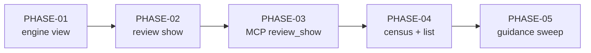

# Implementation Plan SL-278: Review read surface

Prose companion to `plan.toml`. Narrative only — no queried data lives here
(the storage rule); the phase list, criteria, verification, and links are
authored in the TOML. Use this for the plan's rationale and sequencing.
<!-- Reference forms: `lib:reference/glossary.md` § reference forms. -->

## Overview

Five phases, in dependency order: build the read model, put `review show` on
it, put MCP on it, add the census, then sweep guidance.

## Sequencing & Rationale

**PHASE-01 first, invisible.** Everything renders the view, so it lands alone
and pure, proven by unit tests over fixture ledgers before any surface depends
on it. The two extractions (`effective_severity`, `finding_await`) touch the
close gate and derived status; landing them here, with the existing derive and
gate suites unchanged, isolates that behaviour-preservation check from render
churn. `scan_reviews` is engine-tier and has no caller until PHASE-04, but it
belongs with the other ledger readers and is cheap to test in isolation.

**PHASE-02 is the breaking change for the CLI.** Deleting `review::Finding`
forces every user of it to move at once, which includes MCP's
`project_show_summary`. Rather than keep a dead adapter alive for one phase,
PHASE-02 deletes it and points the MCP handler at `Projection::index()`. MCP
is briefly index-only between PHASE-02 and PHASE-03; nothing in the repo
depends on `view=full` in that window, and the phases land back to back.

**PHASE-03 separates transport from render.** The one-shape equality test can
only be written once both transports emit the view, so it lives here. The
`str_list_field` helper is MCP-local and has no other caller.

**PHASE-04 after the single-review surfaces.** The census reuses
`FindingFilter`, `severity_cell`, the warnings channel and `scan_reviews`, so
it lands once all of them are proven. Moving `review list` onto
`scan_reviews` here, with the census, keeps the two corpus walks changing
together.

**PHASE-05 last** because guidance must describe the final surface; doing it
earlier would mean editing the docs twice.

## Notes

- Routed RV-416 findings: none carry `demonstrate`, `probe` or `control`
  routes (F-1 `dedupe`, F-2 `review`, F-3 `refresh`; F-4..F-6 minor), so no
  criterion is transcribed from the ledger.
- Goldens: PHASE-02 regenerates `tests/e2e_review_golden.rs` for `show`. Its
  `list` goldens should stay byte-identical through PHASE-04 because a clean
  corpus prints no `unreadable` line; a diff there is a regression, not a
  regeneration.
