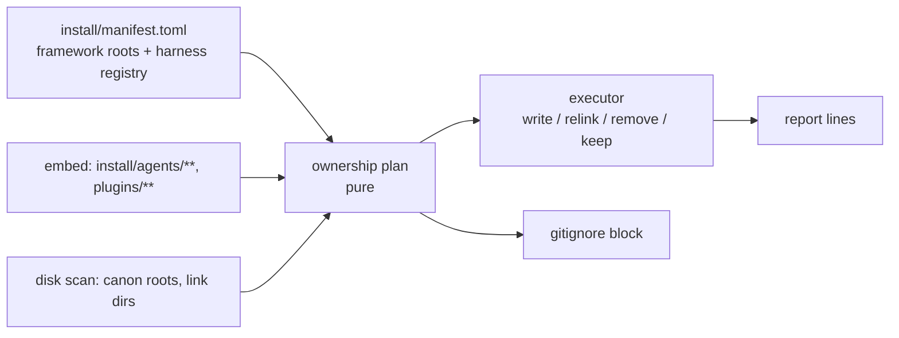
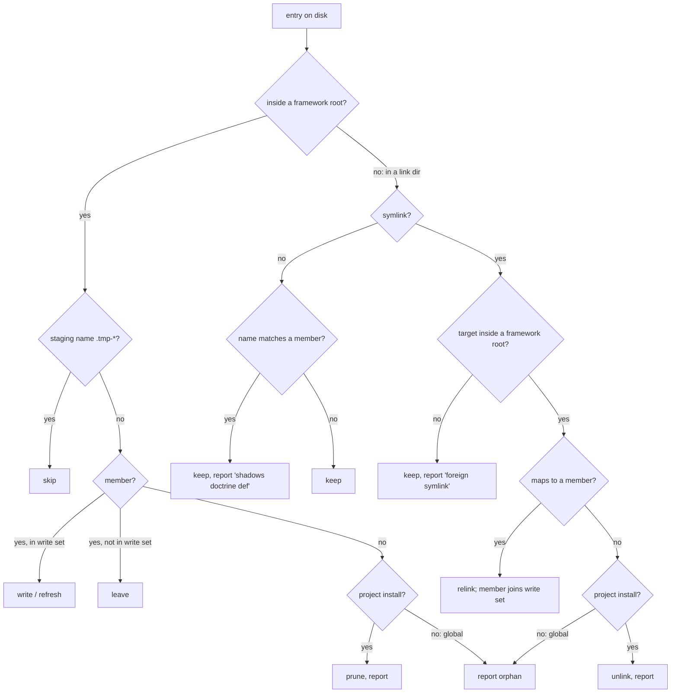

<!-- doctrine:section sec-ownership -->
## Ownership declaration

Ownership is declared once, in `install/manifest.toml` (DEC-373). Nothing else
lists a framework path; gitignore lines, prune scope and link targets all derive
from it.

```toml
[framework]
# Canon roots: wholly framework-owned. A project install converges each to
# exactly the shipped set (anything else inside is removed and reported); a
# global install writes and relinks but only reports orphans (DEC-377).
roots = [".doctrine/agents", ".doctrine/skills", ".doctrine/workflows"]

[harness.claude]
detect = ".claude"
boot = "claude"
agents = ".claude/agents"      # link dir for the def set install/agents/claude/*
skills = ".claude/skills"      # doctrine links skills directly
workflows = ".claude/workflows"

[harness.pi]
detect = ".pi"
boot = "codex"
agents = ".pi/agents"          # def set install/agents/pi/*
skills_via = "universal"       # skills delegated to `npx skills add --agent universal`
```

Rules the declaration carries:

- **The def set is enumerated, not listed.** A harness's defs are the embedded
  files under `install/agents/<harness>/`, read through the existing
  `embedded_agent_defs` seam. Adding a capsule def is adding a file.
- **The registry is the harness vocabulary** (DEC-373, amended by DEC-377).
  Each table also carries `detect` (the directory whose presence implies the
  harness when no `--agent` is given) and `boot` (the boot adapter), replacing
  the hardcoded `detect_agents` list and `boot_harness_names`. The boot set is
  always derived from the resolved harness set through the registry, with or
  without `--agent`. With no `--agent`, install no longer delegates to
  `boot::resolve_harnesses(&[])`, whose separate detector misses `.pi`. That
  detector's one extra rule (a real, non-alias `AGENTS.md` implies codex) is
  kept by unioning its result into the registry-derived set. The standalone
  `doctrine boot` verb keeps its own detection unchanged. The shipped
  registry:

  | harness | detect | boot | agents | skills route |
  |---|---|---|---|---|
  | `claude` | `.claude` | claude | `.claude/agents` | `skills = ".claude/skills"` (doctrine links) |
  | `pi` | `.pi` | codex | `.pi/agents` | `skills_via = "universal"` |
  | `codex` | `.codex` | codex | none yet (IMP-515: `.codex/agents/*.toml`) | `skills_via = "universal"` (codex reads `.agents/skills`) |
  | `universal` | `.agents` | none | none | `skills_via = "universal"` |

  Delegated targets are de-duplicated before the npx call: `--agent pi --agent
  codex` delegates `--agent universal` once. Codex gets no agent defs in this
  slice; today it receives pi's def through the wildcard into `.pi/agents`,
  which it never reads.
- **An unregistered name** (`--agent cursor`) gets no agent defs and no links;
  its skills are still delegated to `npx skills add --agent <name>` as today,
  and install reports the harness as unregistered (DEC-377). There is no
  fallback arm into another harness's defs.
- **User-owned is the default.** Nothing declares it. Any path outside a
  framework root and not a doctrine link is the user's.
- **One legal skills route per harness:** `skills` (doctrine links) or
  `skills_via` (npx target), never both. A manifest test refuses a table with
  both.

Rust side (`src/install.rs`, next to `Manifest`):

```rust
#[derive(Debug, Default, Deserialize)]
struct FrameworkSection { #[serde(default)] roots: Vec<String> }

#[derive(Debug, Deserialize)]
struct HarnessSection {
  detect: Option<String>,
  boot: Option<String>,          // boot adapter name; absent = no boot leg
  agents: Option<String>,
  skills: Option<String>,
  skills_via: Option<String>,
  workflows: Option<String>,
}
// Manifest gains: framework: FrameworkSection,
//                 harness: BTreeMap<String, HarnessSection>
```

Ownership itself is spoken with the framework's existing noun pair,
`hymns::Provenance { Framework, User }`, not a new enum. The constants
`DISPATCH_WORKER_AGENT_ASSET{,_PI}`, the `claude_agents_dir`/`pi_agents_dir`
pair and both `_ => pi` arms are deleted; the harness name indexes the registry.

`DERIVED_RUNTIME` (`src/worktree/allowlist.rs`) keeps its role as the worktree
tier classifier. It already lists `.doctrine/skills/*` and `.doctrine/agents/*`;
a unit test asserts every `[framework] roots` entry is covered by it, so the two
cannot drift (STD-001).

<!-- doctrine:section sec-what-changes -->
## What changes

`doctrine install` writes two kinds of file and today treats them almost alike.
This slice gives install one declared ownership axis (ADR-019's *owned*
property) and makes every write act on it.

- **User-owned** files are the client's customisation: `doctrine.toml`,
  `project-orientation.md`, hymn starters, authored entities. Install writes
  them only if absent and never overwrites, prunes or ignores them. Unchanged.
- **Framework-owned** files are generated from the binary: the canonical copies
  of agent defs, skills and workflows under `.doctrine/`, and the symlinks that
  point harness directories at them. Install now converges them to the embedded
  set: writes every member, refreshes it, removes what is no longer shipped
  (project installs only; a global install reports orphans instead, DEC-377),
  and gitignores the lot through a managed block. Every removal and relink is
  reported (POL-003).

Current vs target:

| concern | today | target |
|---|---|---|
| agent defs per harness | one hardcoded asset (`install_agents_for`) | every def under `install/agents/<harness>/` (DEC-372) |
| canon layout | claude flat, others `<harness>/`, stale `codex/` `universal/` | `.doctrine/agents/<harness>/<def>.md` for every harness |
| refresh | canon rewritten; links healed only on exact-target match | canon rewritten; any link into a canon root is ours and healed |
| prune | none | project: canon roots converge exactly, dead links removed (DEC-374); global: orphans reported, nothing removed (DEC-377) |
| gitignore | hand-kept `[gitignore].entries`, appended | managed block derived from the declaration (DEC-375) |
| harness mapping | Rust constants + two `_ => pi` arms | `[harness.*]` registry in the manifest (DEC-373) |
| pi skills | `npx skills add --agent pi --agent universal` → two roots | one root, the `universal` target |

The boundary: install's *forward legs* (agents, skills, workflows) and its
gitignore step change. The base plan (`[base].backings`, write-if-absent),
memory sync, boot wiring and the hymn-starter leg do not, beyond reading the
shared ownership vocabulary. Migrating files a client already committed stays
out (IMP-378).



The ownership plan is the new pure core: given the declaration, the embedded
catalog and a snapshot of what is on disk, it decides every action. The
executor and the disk scan are the thin impure shell around it.

<!-- doctrine:section sec-code-impact -->
## Code impact

| path | change |
|---|---|
| `install/manifest.toml` | add `[framework] roots`, `[harness.claude|pi|codex|universal]` (detect, boot, agents, skills route); `[gitignore].entries` keeps runtime entries only (drop `.doctrine/skills/*`, now derived) |
| `src/install_ownership.rs` (new) | pure `plan`, `Desired`/`Snapshot`/`Action`, `render_block`, `splice_block` |
| `src/install.rs` | `FrameworkSection`/`HarnessSection` on `Manifest`; desired-set builder over `embedded_agent_defs` + catalog; disk scan; one executor replacing `install_agents_for`/`install_agent_def`/`install_skills_direct`/`install_workflows_for` legs; lexical "into a framework root" test beside `classify_link`; gitignore block written after the forward legs from a re-scan, replacing `Step::Gitignore`; `detect_agents` and `boot_harness_names` read the registry; `install_harnesses` derives the boot set from the registry in both the flagged and unflagged paths, unioning `boot::resolve_harnesses`' AGENTS.md rule; unregistered names keep npx delegation with a disclosure; `.tmp-` staging prefix named; `ensure_gitignored` deleted (no caller once `Step::Gitignore` goes); executor re-proves before each mutation; delete `DISPATCH_WORKER_AGENT_ASSET{,_PI}`, `claude_agents_dir`/`pi_agents_dir`, both `_ => pi` arms; `delegate_argv` receives de-duplicated `skills_via` targets |
| `src/main.rs` | `mod install_ownership;` |
| `src/worktree/allowlist.rs` | `DERIVED_RUNTIME` gains `.doctrine/workflows/*`; test that every `[framework] roots` entry is covered |
| `tests/e2e_claude_install.rs` | walk `install/agents/claude/*.md`; canon path moves to `.doctrine/agents/claude/` |
| `tests/e2e_prompt_def_expansion.rs` | canon path `.doctrine/agents/claude/dispatch-worker.md` |
| `.gitignore` (repo) | generated block; drop `!.doctrine/agents/AGENTS.md` and loose duplicates |
| `.doctrine/agents/AGENTS.md` | `git rm` (pre-minimal-projection relic) |
| `.claude/agents/capsule-*.md` (untracked, local) | delete the hand copies so install links them |
| SPEC-009, REQ-170, REQ-176 (SPEC-010) | via the Revision, at reconcile |

Not touched: `publication/manifest.toml`, `src/asset_source.rs`, the base plan,
hymn-starter leg, memory sync, boot wiring. `src/doctor_checks.rs`'s
`AGENT_SCAN_ROOTS` walks `.doctrine/agents` recursively and needs no change. The
removed constants and leg functions have no callers outside `src/install.rs`.

<!-- doctrine:section sec-convergence -->
## Convergence

How install decides, for every framework-owned path, whether to write, relink,
remove or keep (DEC-374, DEC-377). One pure function decides; the executor
carries out its actions, re-proving each one first.

### Desired set

Membership is drawn from **what is shipped across every registered harness**,
never from this run's `--agent`/`--skill` selection:

- agent canon members: `.doctrine/agents/<harness>/<def>.md` for every
  registered harness with `agents` and every embedded def under
  `install/agents/<harness>/`;
- skill canon members: `.doctrine/skills/<id>` for every entry of the **install
  catalog** — the `discover()` result, which already excludes
  `MARKETPLACE_ONLY_DOMAINS`. A marketplace-only skill is never a member, so
  install never writes or keeps its canon copy;
- workflow canon members: `.doctrine/workflows/<file>` for every embedded
  workflow.

The **write set** is the selected members plus every member that an existing
doctrine link already points at (see *Links*). So a subset install
(`--skill code-review`) prunes nothing still shipped, and a link left by an
earlier install of another harness keeps a live target.

### Links

All registered harnesses' link dirs that exist are scanned, not just this
run's. A **doctrine link** is a symlink whose target lies inside a framework
root:

- a relative value is joined to its link dir and normalised lexically (no
  filesystem follow), so a dangling old-layout link
  (`../../.doctrine/agents/codex/dispatch-worker.md`) still counts;
- an absolute value counts only if it lies under `<base>/<root>` for a framework
  root, compared component-wise;
- anything else is foreign.

A doctrine link is mapped to its member by harness and name. Mapped: its member
joins the write set and the link is relinked to the current layout. Unmapped
(the member is no longer shipped): unlinked. **New** links are created only for
the harnesses selected in this run. A non-symlink entry is never touched; if its
name matches a member it is reported as shadowing.

This widens SPEC-010's REQ-176 (ownership by exact target value) to
ownership by target-inside-a-framework-root; the Revision carries that row.



### Safety boundaries

- **No pruning through a symlink.** Before planning removals for a root or link
  dir, the shell `lstat`s every component from the base (project root or
  `$HOME`) to that directory. If any is a symlink, that directory gets **no
  removals**, and install reports why. This stops a symlinked `.doctrine`,
  canon root or `.claude/skills` from redirecting a prune into another tree.
- **Writes and relinks may follow a symlinked ancestor, by name only.** A
  symlinked `.doctrine` or `.claude` is a relocation the user chose (dotfile
  managers do this routinely), and install follows it today. What makes that
  safe is that a write or relink only ever touches a **member's own path**:
  `WriteCanon` replaces `<root>/<member>` and nothing beside it, and `Relink`
  replaces an entry already re-proven a doctrine link. Neither enumerates or
  removes a non-member name. Removing non-members is the one new destructive
  power, and that is what the guard gates. Refusing all writes under a symlinked
  ancestor would break working relocated setups for no safety gain over this
  rule.
- **Staging never reuses a pre-existing entry.** Today `write_link` blindly
  removes `<dir>/.tmp-<name>`, and `materialise_canonical` clears and then
  writes into `<root>/.tmp-<id>`. Reached through a symlinked ancestor, either
  could delete or overwrite something that isn't doctrine's. All staging,
  link and canon alike, now creates a unique name (`.tmp-<name>.<pid>.<n>`)
  with an exclusive create (`symlink()` for links, `create_dir` rather than
  `create_dir_all` for canon trees), retrying on `EEXIST`. It writes only
  inside what it just created, and removes only that on failure.
- **Staging entries are never pruned.** The `.tmp-` prefix becomes a named
  constant. The plan never removes an entry carrying it, so a concurrent run's
  live staging is safe. A leftover from a crashed run is reported as
  `stale staging <path>` for the user to delete. Crashes are rare, and telling
  live staging from dead would need process-liveness machinery this doesn't
  warrant.
- **Global installs do not prune** (DEC-377). `$HOME/.doctrine/*` has no single
  owner across projects and binary versions, so a global run writes, relinks and
  reports orphans, but removes nothing.
- **Re-prove at mutation time** (SPEC-010 REQ-178). The prune guard is
  re-checked too: a removal re-`lstat`s its ancestor chain first. The executor re-reads each
  link and canon entry immediately before mutating it; if the observation no
  longer matches the plan's, it skips that action and reports it.
- Two install runs at once in the same tree are unsupported; disclosed.

### Shape

New module `src/install_ownership.rs` (sibling of `install_config.rs`), pure:

```rust
pub(crate) struct Desired { members: BTreeSet<Member>, selected: BTreeSet<Member>,
                            new_links: Vec<LinkWant> }   // selected harnesses only
pub(crate) struct Snapshot { canon: Vec<PathBuf>, links: Vec<LinkSeen>,
                             prune_blocked: BTreeSet<PathBuf> }  // symlinked dirs
pub(crate) enum LinkSeen { Symlink { dir, name, value: PathBuf }, Real { dir, name } }
pub(crate) enum Scope { Project, Global }

pub(crate) enum Action {
  WriteCanon(Member),             // agent defs: per-project bake; skills: copy
  Link { dest, target }, Relink { dest, target }, Unlink(PathBuf),
  PruneCanon(PathBuf),
  Report(Notice),                 // Orphan | ForeignSymlink | Shadows | PruneBlocked
}

pub(crate) fn plan(roots: &[PathBuf], scope: Scope, want: &Desired,
                   seen: &Snapshot) -> Vec<Action>;
```

The impure shell (`src/install.rs`) builds `Desired` from the manifest, the
embed and the install catalog; scans canon roots and every registered link dir
into a `Snapshot`; then executes in a fixed order: canon writes, link writes,
unlinks, canon prunes. `--dry-run` prints the plan, including would-prune
actions, and executes nothing. Report lines extend today's
`linked / relinked / kept` with `pruned`, `orphan`, `prune blocked` and
`kept … (real file shadows doctrine def — remove it to receive updates)`.

The agent-def bake (`bake_worker_def`, `WORKER_RESOLVE_MARKER`) is unchanged and
runs inside `WriteCanon`; skills keep `materialise_canonical`'s staged swap.
`install_agent_def`, `install_skills_direct` and `install_workflows_for`
collapse onto this one path.

<!-- doctrine:section sec-gitignore -->
## Gitignore block

Framework gitignore lines live in one managed block in the project's root
`.gitignore`, rewritten in full on every project install (DEC-375).

```gitignore
# >>> doctrine managed — rewritten by `doctrine install`; edit outside this block
.doctrine/state/
.doctrine/slice/*/phases
…
.doctrine/agents/*
.doctrine/skills/*
.doctrine/workflows/*
/.claude/agents/capsule-orchestrator.md
/.claude/agents/dispatch-worker.md
/.claude/skills/audit
…
# <<< doctrine managed
```

(The `…` lines are illustration only. The block holds no inline comments,
because a trailing `#` would become part of the pattern.)

### Contents

Derived, in this order:

1. `[gitignore].entries`: runtime-state paths, still declared by hand because
   install doesn't write them;
2. `<root>/*` for each `[framework] roots` entry;
3. one anchored line per doctrine link present in any registered harness link
   dir **after** the run.

Copies written by `npx skills` (`.agents/skills/<id>`) are **not** listed.
Doctrine can't tell whether it or the user wrote them, so it doesn't claim them.
Install discloses this. IMP-406 replaces the npx route with doctrine links,
which the block then covers.

### When it is written

Last, after every install step, from a **re-scan** of the registered link dirs.
A failed or skipped step therefore shows up as what is actually on disk, and
links from an earlier install of another harness keep their lines. `--dry-run`
prints the block it would write and writes nothing. `--global` writes no block,
because there's no project `.gitignore`. The base plan's per-entry
`Step::Gitignore` items are removed.

### Splice

```rust
pub(crate) fn splice_block(existing: &str, block: &[String])
  -> Result<String, SpliceRefusal>;   // Malformed { starts, ends }
```

- **Exactly one start marker followed by one end marker:** replace the lines
  between them, markers included.
- **No markers:** append the block. If the file doesn't end in a newline, add
  one first.
- **Anything else** (a lone marker, duplicates, end before start): refuse.
  Install leaves `.gitignore` untouched and reports the marker counts.
- **Line endings:** the block uses the file's own (CRLF if the file's first line
  ends in CRLF, LF otherwise).

Lines outside the block are never read for meaning or changed. A user who wants
to ignore less adds `!` rules after the block, and they survive re-install.
Hymns and every user-owned path are never in the block. Lines older installs
appended loose stay where they are (the migration non-goal) as harmless
duplicates.

`ensure_gitignored` is deleted. Its only caller is the base plan's
`Step::Gitignore`, removed above; no other command self-enforces an entry (the
skills caller went with `skills.rs` in IMP-226). Amended at `/plan`. Its test-only
callers migrate with it: `observation_publication_temps_are_ignored` asserts
the entry through the rendered block, the two helper-specific tests retire, and
`embedded_manifest_ignores_the_skills_derived_tree` moves to asserting
`.doctrine/skills/*` comes from the `[framework] roots` glob.

### Dogfood

This repo's `.gitignore` gets the generated block. A unit test asserts the
block's static part (runtime entries and root globs) is present. This repo also
ignores `/.claude/*`, `/.agents` and `/.pi/*` wholesale. Those are its own
deliberate rules outside the block and stay. So this repo **cannot** demonstrate
that no user path is ignored. That invariant is proven by `render_block` unit
tests and the temp-project end-to-end tests. The existing
`every_runtime_gitignore_glob_is_classified` gate requires the new
`.doctrine/workflows/*` line to be classified, so `DERIVED_RUNTIME` gains it.

<!-- doctrine:section sec-revision -->
## Revision

One Revision (REV) over SPEC-009 (the install tech spec), REQ-170 and SPEC-010's REQ-176 (skills distribution), created and
drafted during `/plan` against the spec text current then, approved by the user,
and applied at `/reconcile` once the code proves the behaviour (DEC-376). All
rows are `modify`; excerpts ride in the REV's companion prose.

| target | change |
|---|---|
| SPEC-009 D2 | Split by ownership: user-owned write-if-absent, never overwritten; framework canon roots converge exactly on project installs (global: no prune, orphans reported); shared link dirs prune by recognition; gitignore via a managed block. Dirs stay create-if-missing. |
| SPEC-009 D4 | The manifest also declares `[framework] roots` and the `[harness.*]` registry (detect, boot, agents, skills route). |
| SPEC-009 D5 + Overview boundary paragraph | Rewrite the "skills distribution is a sibling container … install does not own the skill symlink tree, only its gitignore negation" claim: install owns skill canon and links (true since SL-250); the `npx skills` route is the peer mechanism it uses for delegated harnesses. |
| SPEC-009 D7 | Clarified: an explicit `--agent` harness leg installs that harness's defs as integration, not default projection (DEC-372). |
| SPEC-009 manifest section | `[gitignore].entries` become the runtime part of a rewritten managed block, not lines appended. |
| SPEC-009 "Plan then execute" | The plan carries write/relink/unlink/prune actions, not only install/skip; re-install converges framework-owned files rather than being a no-op; user-owned files keep never-overwrite. |
| SPEC-009 Concerns | "Never-overwrite is the safety contract" narrowed to user-owned; "entries are additive" replaced by the managed-block contract. |
| SPEC-009 Hypotheses | "Idempotent never-overwrite is the right default" narrowed to user-owned; "one manifest drives the whole lay-down" extended to the ownership registry. |
| REQ-170 (SPEC-009) | Idempotent: user-owned write-if-absent; framework-owned converge and are reported; dirs create-if-missing; the gitignore block is rewritten. |
| REQ-176 (SPEC-010) | Link ownership by "target lies inside a framework root" instead of exact target value; stale-layout links healed. |

REQ-178 (SPEC-010, re-prove ownership at mutation time) is honoured as written;
no row.

DEC-010's published set (embedded minus base backings) is unchanged — harness
defs are not base backings — so no publication row.

<!-- doctrine:section sec-risks -->
## Risks and residuals

- **A user file inside a canon root is deleted.** By declaration these roots are
  framework-owned and gitignored; the removal is reported by path. Accepted.
- **npx-written skills** (`.agents/skills/<id>`) are neither ignored nor
  pruned; doctrine has no evidence it wrote them. They show as untracked until
  the user ignores them or IMP-406 moves those harnesses to doctrine links.
- **Global installs accumulate orphans** (DEC-377); they are reported, never
  removed. The global agent-def bake is also overwritten by whichever project
  installed last — pre-existing; ISS-520.
- **Concurrent installs** in one tree are unsupported. Staging names are
  protected; nothing else is serialised.
- **Existing clients** keep loose gitignore lines and any committed framework
  files; untracking them is IMP-378.
- **Hymn starters** are still written by install (user-owned, write-if-absent).
  Moving them to customise intent is IMP-513.
- **A missing or stale install** in a fresh checkout gets no guidance yet —
  IMP-514. The wider gitignore contract makes that gap bite more often.
- **Codex has no agent defs.** Codex reads `.codex/agents/*.toml`, which
  doctrine doesn't ship; the registry leaves codex skills-only. Parity is
  IMP-515.

<!-- doctrine:section sec-verification -->
## Verification

Pure-core unit tests (`src/install_ownership.rs`) carry most of the weight:

- `plan_writes_every_member_of_selected_set`
- `plan_prunes_canon_entry_not_in_catalog` / `plan_keeps_unselected_member`
- `plan_relinks_stale_layout_symlink_into_framework_root` (the `codex/` case)
- `plan_unlinks_doctrine_symlink_whose_member_is_gone`
- `plan_keeps_regular_file_and_flags_shadowing` / `plan_keeps_foreign_symlink`
- `plan_repairs_unselected_harness_link_before_pruning_its_old_target` (F-2:
  pi-only run over a flat claude layout)
- `plan_treats_absolute_link_under_root_as_doctrine_and_elsewhere_as_foreign`
- `plan_normalises_dotdot_link_values_lexically`
- `staging_never_reuses_preexisting_entry` (a user file or dir at a staging
  name survives a relink and a canon refresh, including under a symlinked
  `.doctrine`)
- `plan_never_prunes_staging_entries_and_reports_them`
- `plan_blocks_removals_under_symlinked_dir`
- `plan_global_scope_reports_orphans_and_prunes_nothing`
- `plan_excludes_marketplace_only_skills_from_members`
- `plan_prunes_workflow_not_shipped` (workflows embed is empty today, so
  workflow prune is proven here only)
- `plan_orders_canon_writes_before_prunes`
- `splice_block_replaces_between_markers` / `splice_block_appends_when_absent` /
  `splice_block_preserves_user_negations_after_block`
- `splice_block_refuses_lone_or_duplicate_markers`
- `splice_block_adds_newline_to_unterminated_file` / `splice_block_keeps_crlf`
- `render_block_lists_runtime_entries_roots_and_links`
- `render_block_omits_npx_written_skill_copies`
- `render_block_omits_user_owned_paths` (hymns, `doctrine.toml`, entities)

Manifest and wiring tests (`src/install.rs`):

- `harness_table_with_both_skills_and_skills_via_is_refused`
- `pi_and_codex_delegate_universal_once` (over `delegate_argv`)
- `unregistered_harness_delegates_skills_and_reports_unregistered`
- `detection_and_boot_follow_registry` (pi/codex/universal dirs → harness set
  and boot adapters, with and without `--agent`; a real non-alias `AGENTS.md`
  still adds codex)
- existing tests migrated, not dropped: `observation_publication_temps_are_ignored`
  and `embedded_manifest_ignores_the_skills_derived_tree` assert through
  `render_block`; the two `ensure_gitignored_*` tests retire with the helper
- `framework_roots_are_classified_derived_runtime`
- `repo_gitignore_contains_static_block_entries` (dogfood parity)

End-to-end (`tests/e2e_claude_install.rs`, real binary, temp project):

- fresh `--agent claude` installs all four claude defs, capsule defs included,
  each a symlink into `.doctrine/agents/claude/`;
- re-install after editing a canon copy restores it; `doctrine.toml` edits
  survive;
- a planted stale-layout link is relinked; a planted regular file is kept and
  reported; a planted orphan canon file is pruned;
- `.gitignore` carries one managed block, stable across two installs, with a
  user `!` line after it intact;
- `--dry-run` over a tree with an orphan lists the would-prune action and
  changes nothing;
- a planted orphan skill (`.doctrine/skills/retired-skill/` plus a
  `.claude/skills/retired-skill` link into it) is pruned with its link. An
  orphan is exactly "not in the shipped catalog", so the real binary needs no
  synthetic catalog;
- `--agent pi` run with a `PATH` holding no `npx`/`bunx` (the delegate leg's
  spawn fails, non-fatally, as today) still writes pi's defs and a block that
  reflects what landed;
- a write under a symlinked `.doctrine` (pointing into a second temp dir)
  refreshes only member paths there; a planted non-member beside them
  survives, and install reports `prune blocked`;
- no `--agent` in a project with only `.pi/` wires the codex boot adapter;
- `--global` under a temp `$HOME` with a planted orphan reports it and keeps it.

Absence assertions are paired with a positive control (the path existed before
the run), per the vacuous-absence pattern.

Seams that only an in-process test can reach stay in-process. The pure plan
covers a synthetic catalog and removed workflows. `install_for_other` with a
fake `Runner` covers delegate failure in detail. The real-binary tests above
are the command-boundary controls for those behaviours.

