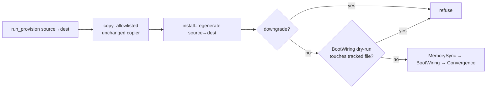

<!-- doctrine:section sec-1 -->
## What changes

Every worktree doctrine provisions gets the derived runtime tier that
`doctrine install` projects, regenerated in place, instead of only the files
`.worktreeinclude` copies (ISS-352).

- **Regenerated** (DEC-402): shipped memory corpus (MemorySync); harness
  config and hooks, e.g. `.mcp.json`, `.pi/settings.json`,
  `.codex/config.toml` (BootWiring); skills, agent defs, workflows and harness
  link dirs (Convergence). The boot snapshot is not a leg: every harness's
  session hook runs `doctrine prompt resolve`, which regenerates it.
- **Not regenerated**: LegacyStarters (edits tracked files), the tracked
  `installed-version` stamp, the local install marker (a linked worktree
  already reads main's marker, `install.rs:3476`; DEC-400/DEC-402).
- **Harness set** is resolved in the *source* tree by the same
  `resolve_install_harnesses` a bare `install` uses, then applied to the
  destination (DEC-393).

<!-- doctrine:section sec-2 -->
## Callers and composition

`run_provision` becomes copy-then-regenerate; the copy is extracted as
`copy_allowlisted(source, dest)` and stays the sole copier (SPEC-012 REQ-189)
(DEC-396).

| caller | role | does |
|---|---|---|
| `worktree fork` (`fork_core`, `fork.rs:189`) | creation | copy + regenerate |
| coordination passthrough (`create.rs:230`) | creation | copy + regenerate |
| dispatch candidate, clean arm (`dispatch.rs:2247`) | creation | copy + regenerate |
| dispatch candidate, conflicted arm (`dispatch.rs:2466`) | creation | copy only, then materialise T_c; prints the repair command |
| `doctrine worktree provision <dir>` (`worktree/mod.rs:388`) | repair | copy + regenerate |

The conflicted arm skips regeneration: before materialise the tree describes
the base, after it the tree may hold conflict markers, and agent defs bake from
on-disk hymns (`install.rs:3352`). It discloses: `derived tier not regenerated
— run 'doctrine worktree provision <dir>' after resolving`.

<!-- doctrine:section sec-3 -->
## Failure and repair

Regeneration legs are **fatal** — unlike `install`, whose forward legs record a
failed outcome and continue (DEC-401). A leg fails on an I/O, bake or wiring
error. Ownership exceptions that convergence already tolerates — a real file
shadowing a doctrine def, a foreign symlink, an entry changed since the scan —
are not failures; they print as `kept` exactly as `install` prints them.

Two refusals run before any write (DEC-399, DEC-402):

- **Downgrade**: the running binary is older than the destination's tracked
  `installed-version`. Refused unless `--allow-downgrade` (on
  `worktree provision` only; creation never downgrades).
- **Stale source wiring**: a dry-run of BootWiring would change a tracked file
  in the destination. On a committed, wired source BootWiring writes only
  gitignored files, so a tracked change means the source's committed wiring is
  stale: `run 'doctrine install' in the source and commit`.

What a failure does depends on the caller's role (DEC-397):

- **Creation** compensates every resource it created. `fork_core` and the
  passthrough already do. The clean candidate arm today rolls back only its
  ref and leaks the detached worktree; it gains the worktree removal
  (`remove_worktree_dir`, widened from `pub(super)`).
- **Repair** never deletes. The legs' progress lines are the disclosure of
  what changed; it exits non-zero and is safe to re-run.

<!-- doctrine:section sec-4 -->
## Code impact

- `src/install.rs`
  - Extract the three legs of `run_forward_steps` (`install.rs:948-1040`)
    into functions returning `anyhow::Result`; `run_forward_steps` maps an
    error to `LegOutcome::failed` as today (behaviour unchanged), `regenerate`
    propagates it.
  - New `pub(crate) fn regenerate(source, dest, allow_downgrade) -> Result<()>`:
    load manifest → resolve harnesses in `source` → downgrade check on `dest`
    → BootWiring dry-run tracked-file guard → MemorySync → BootWiring →
    Convergence. Harness vocabulary stays inside `install` (POL-003).
  - Tracked-file check: `git ls-files` over the dry-run's touched paths,
    through `crate::git`.
- `src/worktree/provision.rs` — extract `copy_allowlisted`; `run_provision`
  composes it with `install::regenerate`; gains `allow_downgrade`.
- `src/worktree/mod.rs` — `Provision` gains `--allow-downgrade`.
- `src/worktree/fork.rs` — `remove_worktree_dir` → `pub(crate)`.
- `src/worktree/allowlist.rs` — correct the `DERIVED_RUNTIME` doc comment and
  `expect(dead_code)` reason (inq-6).
- `src/dispatch.rs` — clean arm removes its worktree on provision failure;
  conflicted arm calls `copy_allowlisted` and prints the repair command.
- `.doctrine/adr/001/layering.toml` — `worktree` gains `→ install`. If the
  command tangle grows, examine the cycle and try to break it before any
  baseline bump (inq-2).
- Docs: `plugins/doctrine/skills/worktree/SKILL.md` (provision = copy +
  regenerate; repair command).
- Tests: `tests/e2e_worktree_fork.rs`, `tests/e2e_worktree_provision.rs`,
  dispatch candidate tests; fixtures in `tests/common/mod.rs`.

<!-- doctrine:section sec-5 -->
## Verification

- **Projection**: after `worktree fork` from an installed source, the fork's
  skills, agent defs, harness link dirs (resolving to real files), harness
  config and shipped memory equal what the running binary projects from the
  fork's own inputs — asserted against an `install` run on a fresh copy, not
  against the source tree.
- **Clean tree**: `git status --porcelain` in a new fork is empty; every
  generated path is ignored.
- **No `.pi/skills`**: pi reads `.agents/skills`; a duplicate makes pi warn.
- **Idempotent repair**: `worktree provision` twice converges; a user-owned
  real file under a harness link dir survives and is reported `kept`.
- **Second generation**: a fork of a fork regenerates the same harness set.
- **Refusals**: downgrade refused (and allowed with `--allow-downgrade` on
  repair); stale tracked wiring refused.
- **Failure compensation per caller**: fork, passthrough and clean candidate
  leave no worktree or ref after an injected regeneration failure; repair
  leaves the worktree in place and exits non-zero; conflicted candidate prints
  the repair command and does not regenerate.
- **Behaviour preservation**: existing `install` suites stay green unchanged
  after the leg extraction.

<!-- doctrine:section sec-6 -->
## Risks and residuals

- **Layering tangle** (ADR-001): `worktree → install` is command→command and
  may grow the ratcheted tangle count.
- **Stale source wiring blocks provisioning** until `doctrine install` is run
  and committed in the source — deliberate, disclosed.
- **Binary freshness**: regeneration uses the running binary's embedded assets
  (forks have no `target/`, ADR-008 D-B1); bounded by the downgrade refusal.
- **Conflicted candidates** stay unregenerated until repaired.
- **Spec drift**: SPEC-012 REQ-189 wording needs the copy/regenerate split —
  a reconcile-time revision. CHR-181 (harness link-dir classification) stays
  out of scope.

