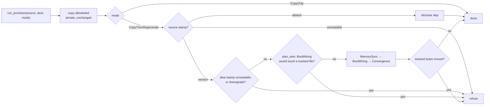

<!-- doctrine:section sec-1 -->
## What changes

Every worktree doctrine provisions gets the derived runtime tier that
`doctrine install` projects, regenerated in place, instead of only the files
`.worktreeinclude` copies (ISS-352).



- **Regenerated** (DEC-402): shipped memory corpus (MemorySync); harness
  config and hooks, e.g. `.mcp.json`, `.pi/settings.json`,
  `.codex/config.toml` (BootWiring); skills, agent defs, workflows and harness
  link dirs (Convergence). The boot snapshot is not a leg: every harness's
  session hook runs `doctrine prompt resolve`, which regenerates it.
- **Not regenerated**: LegacyStarters — a retire-once migration that removes
  unedited starter copies, gated on an *absent* tracked stamp
  (`install.rs:407`), so it never applies in a fork; the tracked
  `installed-version` stamp; the local install marker (a linked worktree
  already reads main's marker, `install.rs:3476`; DEC-400/DEC-402).
- **Uninstalled source**: when the source has no tracked `installed-version`,
  nothing is regenerated, at creation or repair. The copy still runs; the
  command prints `derived tier not regenerated — doctrine not installed in
  <source>` and exits 0 (DEC-399).
- **Harness set** is resolved in the *source* tree by the same
  `resolve_install_harnesses` a bare `install` uses, then applied to the
  destination (DEC-393).

<!-- doctrine:section sec-2 -->
## Callers and composition

`run_provision` stays the single entry point and the sole copier (SPEC-012
REQ-189). It gains a mode argument (DEC-396):

```rust
pub(crate) enum ProvisionMode {
  CopyOnly,
  CopyThenRegenerate { allow_downgrade: bool },
}
pub(crate) fn run_provision(path: Option<PathBuf>, fork: &Path, mode: ProvisionMode)
  -> anyhow::Result<()>
```

The copy stays a private function, so a caller cannot skip regeneration
without writing `CopyOnly` at its call site.

| caller | role | mode | on failure |
|---|---|---|---|
| `worktree fork` (`fork_core`, `fork.rs:189`) | creation | regenerate | existing rollback |
| WorktreeCreate hook passthrough (`create.rs:228`) | creation | regenerate | existing `remove_worktree_dir` |
| coordination worktree (`coordinate.rs:234`) | creation | regenerate | existing `rollback_fork` (create) / `remove_worktree_dir` (resume), `coordinate.rs:240-248` |
| dispatch candidate, clean arm (`dispatch.rs:2247`) | creation | regenerate | rolls back its ref; **gains** worktree removal |
| dispatch candidate, conflicted arm (`dispatch.rs:2466`) | creation | `CopyOnly`, then materialise T_c; prints the repair command | existing `rollback_conflict_worktree` |
| `doctrine worktree provision <dir>` (`worktree/mod.rs:388`) | repair | regenerate, `allow_downgrade` from flag | never deletes |

The conflicted arm skips regeneration: before materialise the tree describes
the base, after it the tree may hold conflict markers, and agent defs bake from
on-disk hymns (`install.rs:3352`). It discloses: `derived tier not regenerated
— run 'doctrine worktree provision <dir>' after resolving`.

<!-- doctrine:section sec-3 -->
## Failure and repair

Regeneration legs are **fatal** — unlike `install`, whose forward legs record a
failed outcome and continue (DEC-401). A leg fails on an I/O, bake or wiring
error. Ownership exceptions that convergence already tolerates — a real file
shadowing a doctrine def, a foreign symlink, an entry changed since the scan —
are not failures; they print as `kept` exactly as `install` prints them. A
leg that returns `Refused` halts regeneration exactly like one that returns
`Failed`.

Progress lines, including boot wiring's (`boot::apply_wire_into`), go to the
writer the caller passes. Provisioning callers pass stderr, so the
machine-read stdout of `worktree fork`, the coordination worktree and
candidate creation is unchanged.

Tracked files must not change. One hazard is predictable and checked before
any write; a post-check catches the rest.

An uninstalled source is skipped, not refused (sec-1). Otherwise four
refusals run before any write (DEC-399, DEC-402):

- **Unreadable source stamp**: regeneration cannot tell an installed source
  from an uninstalled one.
- **Unreadable destination stamp**: regeneration cannot verify it is not a
  downgrade.
- **Downgrade**: the running binary is older than the destination's tracked
  `installed-version`. Refused unless `--allow-downgrade` (on
  `worktree provision` only; creation never downgrades). An absent
  destination stamp is not a downgrade.
- **Stale source wiring**: BootWiring would change a tracked file in the
  destination. `apply_wire` cannot answer this — under dry run it discards
  what it would touch (`boot.rs:3448`, `:3456`) — so a new
  `boot::plan_wire(root, exec, harnesses) -> Result<Vec<Touched>>` runs the
  same dry-run arms and keeps their paths (`import_touched`,
  `refresh_touched`). `regenerate` intersects them with `git ls-files`. On a
  committed, wired source BootWiring writes only gitignored files, so a
  tracked hit means the source's committed wiring is stale: `run 'doctrine
  install' in the source and commit`.

One check runs after the legs:

- **Tracked drift**: snapshot every tracked-dirty path and its bytes before
  and after the legs. A path is drift if it became dirty, if a leg rewrote a
  file that was already dirty, or if a leg reverted one to clean (the
  uncommitted edit is gone). Any drift is a regeneration failure naming the
  paths. It covers what
  the preflight does not predict — e.g. convergence pruning or unlinking an
  entry a client has un-ignored and committed under a canon root
  (`install_ownership.rs:289-290`).

What a failure does depends on the caller's role (DEC-397):

- **Creation** compensates every resource it created. `fork_core`, the hook
  passthrough, the coordination worktree and the conflicted candidate arm
  already do. The clean candidate arm today rolls back only its ref and leaks
  the detached worktree; it gains the worktree removal (`remove_worktree_dir`,
  widened from `pub(super)`).
- **Repair** never deletes and never restores. The legs' progress lines and
  the drift check's path list disclose what changed; it exits non-zero and is
  safe to re-run. The user decides what to revert.

<!-- doctrine:section sec-4 -->
## Code impact

- `src/install.rs`
  - Extract the three legs of `run_forward_steps` (`install.rs:948-1040`)
    into functions returning `anyhow::Result`; `run_forward_steps` maps an
    error to `LegOutcome::failed` as today (behaviour unchanged), `regenerate`
    propagates it.
  - New `pub(crate) fn regenerate(source, dest, allow_downgrade, out) ->
    Result<()>`: source stamp (absent → skip; unreadable → refuse) → load
    manifest → resolve harnesses in `source` → destination stamp (unreadable
    or downgrade → refuse) → `plan_wire` ∩ tracked paths guard → drift
    snapshot → MemorySync → BootWiring → Convergence → drift check. Harness
    vocabulary stays inside `install` (POL-003).
- `src/git.rs` — `tracked_paths` and `tracked_dirty_paths`; every git call
  `regenerate` makes goes through `crate::git`.
- `src/boot.rs` — new `plan_wire`: a third `WirePass::DryRunPlan` pass
  through the same wiring arms, which computes the dry-run report and also
  collects the touched paths. `apply_wire` and its pinned dry-run test
  (`boot.rs:8013`) stay unchanged. `apply_wire_into` takes the caller's
  writer, so wiring progress reaches stderr for provisioning callers.
- `src/worktree/provision.rs` — `ProvisionMode`; `run_provision` gains the
  mode and composes the private copy with `install::regenerate`.
- `src/worktree/mod.rs` — `Provision` gains `--allow-downgrade`; re-exports
  `ProvisionMode`.
- `src/worktree/{fork,create,coordinate}.rs` — pass
  `CopyThenRegenerate { allow_downgrade: false }`. `remove_worktree_dir` →
  `pub(crate)`.
- `src/worktree/allowlist.rs` — correct the `DERIVED_RUNTIME` doc comment and
  `expect(dead_code)` reason (inq-6).
- `src/dispatch.rs` — clean arm passes regenerate and removes its worktree on
  failure; conflicted arm passes `CopyOnly` and prints the repair command.
- `.doctrine/adr/001/layering.toml` — `worktree::provision` and
  `worktree::fork` re-tiered engine → command: provision composes
  `install::regenerate`, and fork calls provision — the same upward-edge
  shape `worktree::coordinate` is already command-tier for. All their
  importers are command tier. The `worktree` comment gains `install`. The
  command tangle baseline stays `command = 76`: the measured delta is 0, not
  the +1 predicted (inq-2; QUE-229 answered keep).
- Docs: `plugins/doctrine/skills/worktree/SKILL.md` (provision = copy +
  regenerate; repair command).
- Tests: `tests/e2e_worktree_fork.rs`, `tests/e2e_worktree_provision.rs`,
  `tests/e2e_worktree_create_fork.rs`, `tests/e2e_worktree_coordinate.rs`,
  `tests/e2e_dispatch_candidate.rs`; fixtures in `tests/common/mod.rs`.

<!-- doctrine:section sec-5 -->
## Verification

- **Projection**: after `worktree fork` from an installed source, the fork's
  skills, agent defs, harness link dirs (resolving to real files), harness
  config and shipped memory equal what the running binary projects from the
  fork's own inputs — asserted against an `install` run on a fresh copy, not
  against the source tree.
- **Clean tree**: `git status --porcelain` in a new fork is empty; every
  generated path is ignored. The fixture ignores `/.codex` itself, so this is
  proven relative to a clean source: the shipped managed `.gitignore` block
  lacks `.codex/` (ISS-531).
- **No `.pi/skills`**: pi reads `.agents/skills`; a duplicate makes pi warn.
- **Idempotent repair**: `worktree provision` twice converges; a user-owned
  real file under a harness link dir survives and is reported `kept`.
- **Second generation**: a fork of a fork regenerates the same harness set.
- **Uninstalled source**: creation and repair copy only, print the skip line
  and exit 0.
- **Refusals**: unreadable source or destination stamp refused; downgrade
  refused (and allowed with `--allow-downgrade` on repair), an absent
  destination stamp is not one; stale tracked wiring refused (`plan_wire`
  reports a tracked path); tracked drift after the legs refused, naming the
  paths, including a rewritten or reverted pre-dirty file; a `Refused` leg
  halts.
- **Stdout unchanged**: regeneration progress goes to stderr for fork,
  coordination and candidate creation.
- **Failure compensation per caller.** The e2e tests drive the built binary as
  a subprocess, so the failure lever is data, not injection: the source
  commits `installed-version = "999.0.0"`, the new worktree inherits it, and
  the downgrade refusal fires before any write.
  - fork, hook passthrough, coordination (create and resume) and clean
    candidate: no worktree, ref or ledger row left behind (resume keeps its
    pre-existing branch).
  - repair: worktree kept, non-zero exit; `--allow-downgrade` then succeeds.
  - conflicted candidate: does not regenerate and prints the repair command.
  - The implementer confirms no earlier currency check refuses on the raised
    stamp before regeneration runs.
- **Behaviour preservation**: existing `install` suites and `apply_wire`
  tests stay green unchanged after the leg extraction and `plan_wire`.

<!-- doctrine:section sec-6 -->
## Risks and residuals

- **Layering tangle** (ADR-001): resolved by the re-tier in sec-4; measured
  delta 0, baseline unchanged.
- **Stale source wiring blocks provisioning** until `doctrine install` is run
  and committed in the source — deliberate, disclosed.
- **Binary freshness**: regeneration uses the running binary's embedded assets
  (forks have no `target/`, ADR-008 D-B1); bounded by the downgrade refusal.
- **Baked binary path**: gitignored harness config renders hook commands as
  `<abs exec> <args>` (`CommandForm::Baked`, `boot.rs:1105-1119`) — codex
  hooks always (`boot.rs:2854`), claude local settings (`boot.rs:594-599`).
  Only tracked files get `${DOCTRINE_BIN:-doctrine}`. A fork's ignored config
  therefore pins the provisioning binary's path. Observed in PHASE-03: it
  resolves inside the Linux worker jail, because the jail read-only binds the
  host root. Residual: rebuilding or deleting the minting tree changes or
  breaks the fork's codex hooks; a jail that stops binding `/`, or the macOS
  arm (not probed), needs re-checking.
- **Conflicted candidates** stay unregenerated until repaired.
- **Spec drift**: SPEC-012 REQ-189 wording needs the copy/regenerate split —
  a reconcile-time revision. CHR-181 (harness link-dir classification) stays
  out of scope.

