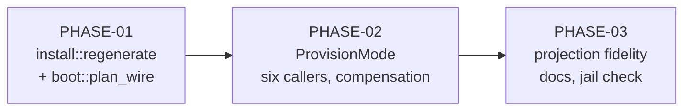

# Implementation Plan SL-285: Fork regenerates derived runtime

Prose companion to `plan.toml`. Narrative only — no queried data lives here
(the storage rule); the phase list, criteria, verification, and links are
authored in the TOML. Use this for the plan's rationale and sequencing.
<!-- Reference forms: `lib:reference/glossary.md` § reference forms. -->

## Overview

Three phases, inside-out: build the regeneration engine in `install`, wire it
into every provisioning caller, then prove what a provisioned worktree holds.

## Sequencing & Rationale

- **PHASE-01 first** because every caller depends on `regenerate`, and its
  refusals are cheapest to test in-crate, where a stale tracked wiring file
  or a raised stamp is a few lines of fixture. The leg extraction is shared
  machinery, so the existing install suites are the behaviour-preservation
  gate. RV-425 F-1's negative control lands here because the guard is born
  here.
- **PHASE-02** threads the mode through `run_provision` and its six callers in
  one phase: changing the signature forces every call site at once, and the
  compensation tests (RV-425 F-6) need all of them. The uninstalled-source
  skip from PHASE-01 is what keeps the roughly 18 existing fork-creating test
  files green without fixture edits. The layering edge appears here, so the
  tangle is measured here.
- **PHASE-03** needs a real installed-source fixture (`installed_source`),
  the slowest tests in the slice; they come last, once the wiring is stable.
  Docs and the F-7 confined-fork check close the phase.

## Notes

- **Uninstalled source.** The locked design does not cover a source with no
  tracked `installed-version`. The user chose (2026-10-23) to copy only and
  disclose, exit 0, for creation and repair alike; the design sections and a
  decision record are integrated at reconcile (slice notes § Reconcile carry).
  PHASE-01 EX-6 carries it.
- **Failure lever.** The e2e suites run the built binary, so failure is
  injected as data: a committed `installed-version = "999.0.0"`.
