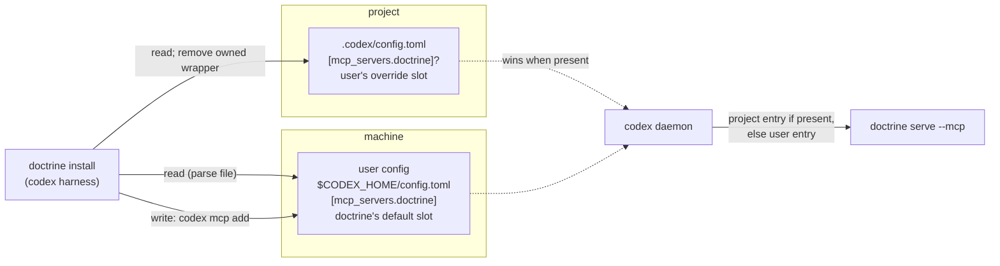

<!-- doctrine:section sec-code-impact -->
## Code impact

| path | change |
|---|---|
| `src/codex_mcp.rs` (new, command tier) | the leg: `CodexUserPlan`, `plan` (pure), user/project classification, consent text, report lines, `CodexCli` runner trait + process impl, `execute`; moves the codex MCP pieces out of `boot.rs` (`CODEX_MCP_*` constants, `classify_codex_entry`, the project-file edit) |
| `.doctrine/adr/001/layering.toml` | register `codex_mcp = "command"` (→ boot for `resolve_exec`/`Harness`, fsutil, dtoml) |
| `src/main.rs` | register `codex_mcp` |
| `src/boot.rs` | codex arm of `install_refresh` drops the MCP leg (`mcp: NotApplicable`); remove `install_codex_mcp`, `plan_codex_mcp`, `codex_mcp_entry`, `codex_mcp_fallback_snippet` and their `wire()` lines and `mcp_rel` codex row; `run_install` (boot install) builds the plan, asks consent, runs the leg |
| `src/install.rs` | `InstallPlan.codex_user_mcp: Option<CodexUserPlan>` (codex harness only); overview bullet; consent question after `confirm_install`; `Leg::CodexUserMcp` in `run_forward_steps` after boot wiring; `print_details` section; *not* in `regenerate` (DEC-411) |
| `src/commands/cli.rs` | `-y` help on `install` and `boot install` states it grants user-level consent |
| `src/mcp_server/mod.rs`, `src/mcp_server/tools.rs` | `Option<root>`; rootless initialize / list / call |
| `src/commands/serve.rs` | unchanged signature; passes through |
| `tests/e2e_codex_install.rs` | rewritten around a fake `codex` on PATH recording argv, temp `HOME`/`CODEX_HOME`; project retirement; consent / decline / `-y`; degradation; regeneration leaves user config untouched |
| `tests/e2e_mcp_server.rs` | rootless handshake outside a project and in a git repo without `.doctrine/` |

`README.md` changes at reconcile, not in a phase (see Revision).

Design-target selectors record exactly these paths.

<!-- doctrine:section sec-leg -->
## The codex user MCP leg

### Plan (pure)

`plan(user_toml: Option<&str>, project_toml: Option<&str>, exec, project_root,
env) -> CodexUserPlan`. No I/O. The shell supplies the two file texts (absent →
`None`), the resolved exec, the root and the env facts (`CODEX_HOME` value, `HOME`
present, `codex` on PATH).

1. **Destination** (DEC-408). An empty `CODEX_HOME` counts as unset.
   `CODEX_HOME` set → `$CODEX_HOME/config.toml`. A relative or non-existent
   `CODEX_HOME` → `Degraded(BadCodexHome)`. Unset → `$HOME/.codex/config.toml`.
   No `HOME` → `Degraded(NoHome)`. The plan always carries the resolved path for
   the report.
2. **Bake guard** (DEC-404). If `exec`, canonicalised, `starts_with` the
   canonicalised project root (whole components) → `Degraded(ExecInProject)`.
3. **User entry** (DEC-406), classified by table name:
   - absent → `Add`;
   - a table with `command` a string and `args` a string array → `Current` when
     command == exec and args == `["serve","--mcp"]`, else `Replace { old }`;
   - otherwise (not a table, wrong types) → `Degraded(Malformed)`.

   `Replace` and `Add` carry `dropped`: every key other than `command`/`args`
   (EVD-033: `mcp add` drops them).
4. **Project entry** (DEC-406, form-classified):

   | project `[mcp_servers.doctrine]` | class | effect |
   |---|---|---|
   | absent | — | nothing |
   | wrapper in `CODEX_MCP_WRAPPER_FORMS` (existing predicate) | `OwnedWrapper` | removed with the user write |
   | `command` contains `/` (absolute or relative) | `Override` | untouched; reported; not incomplete |
   | `command` is a bare name | `PathShadow` | untouched; warned; holds incomplete |
   | empty `command`, wrong types, not a table | `Malformed` | untouched; snippet; holds incomplete |
   | unparseable project file | `Unreadable` | untouched; disclosed; holds incomplete |

5. **Codex CLI.** `codex` absent from PATH, with a user write pending →
   `Degraded(NoCodexCli)`.

The plan *proposes a change* when the user entry is `Add`/`Replace` or the project
entry is `OwnedWrapper`, and nothing is degraded.

### Consent (DEC-403)

Asked only when the plan proposes a change, after install's `Proceed?` and before
any leg runs. `-y` consents. `--dry-run` shows the question's content without
asking. Default No.

```text
Codex: register doctrine's MCP server in your user config?
  file     /home/u/.codex/config.toml  [mcp_servers.doctrine]
  runs     codex mcp add doctrine -- /home/u/.local/share/doctrine/bin/doctrine serve --mcp
  scope    every codex session on this machine, in every project
  replaces doctrine serve --mcp                         (only when replacing)
  drops    enabled = false, env.FOO                     (only when keys are dropped)
  removes  the old doctrine wrapper in .codex/config.toml   (only when present)
  Codex asks you to trust each new folder before doctrine connects there.
Write user config? [y/N]
```

`boot install` asks the same question after its own `Wire doctrine boot …?`
prompt, with the same `-y` rule.

### Execute (thin shell)

- **Declined** → no change in either layer (the wrapper stays, so codex keeps its
  current server). Print the `codex mcp add …` line and the EVD-032 warning.
  `LegOutcome::Done` with nothing touched.
- **Consented** → run `codex mcp add …` through an injected `CodexCli` runner.
  On success, remove an `OwnedWrapper` from the project file (existing
  edit-preserving `toml_edit` path, `write_atomic`). `Done` touches the project
  file only; the user file is outside the repo and is never a commit-hint path.
  On failure → `Refused`, with codex's stderr disclosed and the project file left
  untouched.
- **Degraded / PathShadow / Malformed / Unreadable** → no writes. Print the cause
  and the `codex mcp add …` line (or the snippet). `LegOutcome::Refused`:
  install continues, and the closing summary names the leg (DEC-408: degraded,
  never failed).
- **Current, no project change** → `Done`, one "current" line.
- **Override** never blocks the user write. It is reported alongside it.

Every user write is followed by the daemon hint: an already-running codex daemon
keeps its old config until restarted (EVD-032).

<!-- doctrine:section sec-model -->
## System model



Two layers with different owners:

| layer | role | doctrine reads | doctrine writes |
|---|---|---|---|
| user | doctrine's default slot (DEC-406) | parses the file directly; `codex mcp get` shows the *effective* entry, not the user layer (ASM-015 invalidated) | `codex mcp add doctrine -- <exec> serve --mcp` (EVD-033), after consent |
| project | the user's override slot | parses `.codex/config.toml` (existing code) | removes only an owned wrapper (`CODEX_MCP_WRAPPER_FORMS`), after consent |

One new install leg, **codex user MCP**, owns both layers' MCP handling. It runs
only from an explicit `doctrine install` or `doctrine boot install` (DEC-411),
never from worktree regeneration or provisioning. The per-project harness refresh
(`install_refresh`'s codex arm) stops touching MCP entirely. It keeps the codex
hooks.

<!-- doctrine:section sec-problem -->
## Design problem

Interactive codex starts MCP servers from a long-lived app-server daemon whose
PATH is frozen at daemon start (EVD-032). The project-level `sh -c` wrapper that
`boot install` writes today (DEC-323) depends on that PATH, so on a machine where
the daemon's PATH lacks doctrine, codex reports a handshake failure. Only an
absolute `command` survives, and POL-002 forbids writing one into a file a client
repo may track.

The user-level codex config is not such a file. This design moves doctrine's codex
MCP registration there, with the user's consent, through codex's own CLI. It
retires doctrine's project-level wrapper, which would otherwise shadow the
user-level entry, since codex prefers the project layer. It keeps the project
layer free for per-project overrides. It also makes `serve --mcp` harmless in the
directories a machine-wide entry now reaches.

Governing records: DEC-403 (user level, with consent), DEC-404 (bake guard),
DEC-405 (rootless serve), DEC-406 (ownership per layer), DEC-407 (report),
DEC-408 (degradation), DEC-409 (`DOCTRINE_BIN` dropped), DEC-410 (out-of-repo
write rule), DEC-411 (explicit install only), EVD-032, EVD-033, ASM-014.

<!-- doctrine:section sec-report -->
## Report and dry-run

The leg prints its own lines (DEC-407 as amended); `RefreshReport.mcp` is
`NotApplicable` for codex and `mcp_rel` loses its codex row. Examples:

User write plus retired wrapper:

```text
codex: registered doctrine MCP server in /home/u/.codex/config.toml
  command /home/u/.local/share/doctrine/bin/doctrine serve --mcp
codex: removed the old doctrine wrapper from .codex/config.toml
codex: a running codex app-server keeps its old config until restarted
```

Replace, keys dropped:

```text
codex: replaced doctrine MCP command in /home/u/.codex/config.toml
  was     doctrine serve --mcp
  now     /home/u/.local/share/doctrine/bin/doctrine serve --mcp
  dropped enabled = false
```

Project override in effect (user write still done or current):

```text
codex: project override in effect: ./bin/doctrine (.codex/config.toml) — codex uses it here instead of the user entry
```

PATH-dependent shadow:

```text
codex: .codex/config.toml has a doctrine entry with command "doctrine"; it overrides the user entry here
  and needs doctrine on the codex daemon's PATH, which may fail (EVD-032). Use an absolute path, or remove it.
install incomplete: codex user MCP
```

Degraded:

```text
codex: user MCP registration skipped — codex is not on PATH
  run: codex mcp add doctrine -- /home/u/.local/share/doctrine/bin/doctrine serve --mcp
install incomplete: codex user MCP
```

Declined:

```text
codex: user MCP registration declined; nothing changed
  interactive codex may fail to start doctrine if its daemon's PATH lacks doctrine (EVD-032)
  to register later: codex mcp add doctrine -- /home/u/.local/share/doctrine/bin/doctrine serve --mcp
```

The report states what was written, never that codex has loaded it (POL-003).

**Dry-run** builds the plan (two file reads, no `codex` invocation). It prints the
consent block's content under the existing dry-run headings, and never writes
either layer. The overview gains one bullet when the plan proposes a change:
`codex  register doctrine's MCP server in your user codex config (asks first)`.

<!-- doctrine:section sec-revision -->
## Revision and reconcile

At reconcile, one REV against SPEC-011:

- **REQ-484** rewritten. Install, with consent, registers doctrine in the codex
  user config via `codex mcp add` with an absolute command. It owns the user table
  by name and removes doctrine's project-level wrapper. It classifies other
  project entries by form, discloses and degrades rather than failing, runs only
  on explicit install, and reports what was written, never activation.
- A requirement for rootless `serve --mcp` (DEC-405), placed where `serve --mcp`'s
  behaviour is specified (to locate at reconcile).

Supersessions, recorded with `doctrine supersede` at reconcile: DEC-323 and
DEC-332 by DEC-406, and DEC-325 by DEC-407.

README, also at reconcile:

- the user-level entry and its scope;
- the consent prompt, and that `-y` grants it;
- the project-level override slot and how to use it;
- codex's per-folder trust prompt;
- the codex CLI as a declared dependency of the codex harness;
- removal of the `sh` dependency declaration.

<!-- doctrine:section sec-risks -->
## Risks and residuals

| risk | mitigation / residual |
|---|---|
| A hand-written user entry is replaced | consent prompt shows old → new and dropped keys; `-y` prints them; overrides belong in the project layer |
| A dev build of *another* checkout is baked | accepted (DEC-404); the baked path is printed |
| A `/nix/store` path breaks after garbage collection | RSK-234 (shared with codex hooks) |
| `codex mcp add` flags or semantics change | read path is independent; runner failure → `Refused` with codex stderr; EVD-033 pins 0.159.1 behaviour |
| Codex hides the rootless `instructions` | ASM-014; an empty tool list remains the signal |
| Regeneration writes user config | DEC-411; e2e asserts regeneration leaves a temp user config byte-identical |
| Jail installs have no codex / a different home | degrade with the pasteable line; expected inside the jail |
| A `PathShadow` keeps install incomplete | intended, with the cause named (partially resolves ISS-528); an absolute override does not |
| Codex behaviour beyond tested versions | probes cover CLI 0.159.1 and daemon 0.163.0/0.164.0 |

<!-- doctrine:section sec-serve -->
## Rootless serve (DEC-405)

`mcp_server::serve` resolves `Option<root>`: `root::find` succeeding *and*
`<root>/.doctrine/` existing gives `Some(root)`; otherwise `None`. With `None`:

- `initialize` succeeds; its `instructions` say "no doctrine project here
  (no project root, or no .doctrine/ under <root>)". Whether codex displays this is
  ASM-014.
- `tools/list` returns `[]`.
- `tools/call` returns a JSON-RPC error naming the same cause (defensive; no tool
  is advertised).

With `Some(root)`, behaviour is unchanged. `--path` keeps its meaning: an
explicit root without `.doctrine/` is also rootless.

<!-- doctrine:section sec-verification -->
## Verification

Unit (pure, `codex_mcp`):

- `plan` matrix:
  - user entry: absent / current / replace / replace with dropped keys / malformed;
  - project entry: absent / owned wrapper / absolute override / relative override /
    bare-name shadow / empty command / wrong types / unparseable;
  - destination: `CODEX_HOME` unset / empty / relative / missing; no `HOME`;
  - bake guard: exec inside root, sibling-prefix path (`/repo/app` vs
    `/repo/application`), symlinked root;
  - `codex` absent.
- Consent text and report lines per outcome (constants, STD-001).

Shell (`execute` with a fake `CodexCli`):

- consented: one `add` with the exact argv, then wrapper removed;
- `add` fails: `Refused`, project untouched;
- declined: zero calls, nothing written;
- degraded: zero calls.

E2E (binary-driven, fake `codex` on PATH, temp `HOME`/`CODEX_HOME`):

- `install -y`: argv recorded and the project wrapper removed;
- interactive decline: nothing changed;
- `--dry-run`: no `codex` invocation and no writes;
- `install` regeneration of a fork: the user config is byte-identical and there is
  no `codex` call;
- `boot install -y`: same as install.

MCP:

- rootless handshake (no root; git repo without `.doctrine/`): `tools/list` is
  `[]`, `instructions` names the cause;
- a doctrine project is unchanged.

VH:

- interactive codex in this repo connects after `doctrine install`, with a daemon
  whose PATH lacks doctrine;
- ASM-014: where codex shows the rootless instructions.

